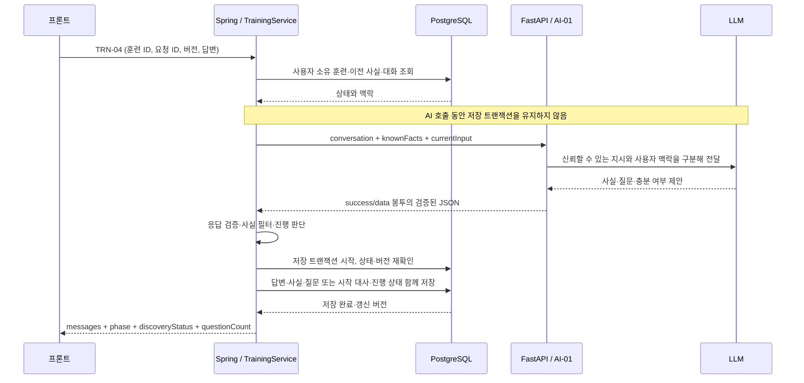

# AI-01 Spring·DB·FastAPI 연결 설계

## 이 문서의 기준

상황 파악 대화가 정상적으로 이어지려면 Spring이 사용자 답변을 받아 DB의 이전 정보와 합치고, FastAPI가 그 맥락으로 사실·다음 질문을 제안하고, Spring이 결과를 검증해 한 번만 저장해야 해요. 이 문서는 그 연결과 파일별 책임을 설명해요.

Spring 파일과 V1·V2 SQL은 현재 저장소의 구현 기준이에요. FastAPI 코드는 이 저장소에 없으므로 아래 Python 파일명은 필요한 역할을 설명하는 **제안 구조**예요. 실제 FastAPI가 이미 이렇게 구현됐다는 뜻은 아니에요. 팀용 DB 연결과 실제 LLM 통합은 아직 완료하지 않았고, 기존 SQL을 적용한 별도 로컬 테스트 DB와 Fake AI·가짜 HTTP 응답으로 검증한 상태예요.

관련 규칙과 실행법은 [AI-01 개발·검증 안내](ai-01-discovery.md), 전체 경로는 [API 기준](api.md)을 참고해요.

## 전체 연결



브라우저는 Spring만 호출해요. 훈련에 사용자를 연결하고 DB에 저장하는 주체도 Spring이에요. FastAPI는 로그인 세션이나 훈련 DB의 소유권을 대신 판단하지 않으며, 이 계약에서는 대화 상태를 보관하지 않아요. 다음 호출에서도 Spring이 필요한 맥락을 다시 보내요.

## Spring 파일은 이렇게 연결돼요

| 파일 | 받아서 하는 일 | 다음에 연결하는 파일·데이터 |
|---|---|---|
| [TrainingController](../src/main/java/com/wsid/training/controller/TrainingController.java) | `/api/trainings/{id}/discovery/messages`의 형식 검증 | `SubmitTurnRequest`를 `TrainingService.submitDiscovery`에 전달 |
| [SubmitTurnRequest](../src/main/java/com/wsid/training/dto/SubmitTurnRequest.java) | UUID 요청 ID·버전 필수, 답변 공백 불가·최대 1000자 | 잘못된 입력은 AI 호출 전에 400 |
| [CurrentUser](../src/main/java/com/wsid/auth/CurrentUser.java) | 요청 사용자의 ID 제공 | 서비스가 훈련 ID와 사용자 ID를 함께 조회 |
| [TrainingService](../src/main/java/com/wsid/training/service/TrainingService.java) | 조회 → AI 호출 → 재검증 → 저장 순서 조율 | repository, `AiClient`, domain, 응답 DTO 연결 |
| [TrainingSessionRepository](../src/main/java/com/wsid/training/repository/TrainingSessionRepository.java) | `findByIdAndUserId`로 소유자 조건 조회 | `training_sessions`의 상태·버전·사실 |
| [TrainingMessageRepository](../src/main/java/com/wsid/training/repository/TrainingMessageRepository.java) | DISCOVERY 메시지를 순번순으로 조회, 요청 ID 확인, 메시지 저장 | `conversation`과 중복·순서 관리 |
| [AiClient](../src/main/java/com/wsid/ai/AiClient.java) | `suggestDiscovery`라는 내부 호출 인터페이스 | 설정에 따라 Fake 또는 HTTP 구현 |
| [AiClientConfig](../src/main/java/com/wsid/ai/AiClientConfig.java) / [AiProperties](../src/main/java/com/wsid/ai/AiProperties.java) | 구현 선택·주소·키·시간 제한 주입 | `FakeAiClient` 또는 `HttpAiClient` |
| [HttpAiClient](../src/main/java/com/wsid/ai/HttpAiClient.java) | AI-01 HTTP 호출, 성공 봉투·필드 유형 검증 | `DiscoveryResult` 또는 `AiUnavailableException` |
| [ContextFacts](../src/main/java/com/wsid/training/domain/ContextFacts.java) | JSONB 읽기·쓰기, 사실 필터·얕은 병합·필수 키 확인 | 사용자 사실을 보존한 새 `ContextFacts` |
| [TrainingSession](../src/main/java/com/wsid/training/domain/TrainingSession.java) | 답변 수 증가·준비 판정·활동 시각 갱신 | `DiscoveryOutcome`, `FlowState`, 세션 엔티티 |
| [FlowState](../src/main/java/com/wsid/training/domain/FlowState.java) | 핵심 장면 여부와 상황 파악 상태를 함께 직렬화 | `flow_state_json`; 한 상태 변경 시 다른 상태 보존 |
| [DiscoveryQuestions](../src/main/java/com/wsid/training/service/DiscoveryQuestions.java) / [ReviewedTexts](../src/main/java/com/wsid/training/service/ReviewedTexts.java) | AI 실패 시 빈 사실에 맞는 대체 질문 선택 | 검토된 질문 또는 기본 시나리오 안내 |
| [DiscoveryResponse](../src/main/java/com/wsid/training/dto/DiscoveryResponse.java) | 프론트에 새 버전·상태·질문 수·메시지 목록 반환 | 다음 요청과 화면 전환의 기준 |
| [SessionStateResponse](../src/main/java/com/wsid/training/dto/SessionStateResponse.java) | 저장된 대화·진행 상태 복원 | 새로고침·409 이후 상태 재조회 |

현재 local 프로필의 `CurrentUser`는 개발 계정을 사용해요. 실제 세션 로그인과 쿠키 검증을 구현했다는 뜻은 아니에요. 회원 인증이 구현되면 사용자 식별 부분을 연결하되, 프론트가 보낸 사용자 ID를 소유권 증명으로 사용하지 않아요.

## DB에서 준비할 구조와 파일

스키마 생성은 [V1__init_schema.sql](../src/main/resources/db/migration/V1__init_schema.sql), 외래키·유니크 제약은 [V2__add_constraints.sql](../src/main/resources/db/migration/V2__add_constraints.sql)이 담당해요. Flyway가 시작 시 순서대로 적용하고, JPA는 `ddl-auto: validate`로 엔티티와 테이블 일치를 검사해요. FastAPI가 이 SQL을 실행하거나 테이블을 수정하는 구조가 아니에요.

| 테이블·컬럼 | Spring에서 연결되는 부분 | 정상 동작을 위한 의미 |
|---|---|---|
| `users.id` | CurrentUser가 제공한 회원 ID | `training_sessions.user_id`의 외래키 대상이 실제로 존재해야 함 |
| `training_sessions.id`, `user_id` | TrainingSessionRepository | 누구의 훈련인지 확인; 다른 회원의 훈련은 404 |
| `phase`, `status` | `requireCurrent`, `requireDiscovery` | 종료·만료·잘못된 단계 요청은 저장·AI 호출 전에 거절하고 저장 직전에도 재확인 |
| `context_facts` (JSONB) | `ContextFacts` ↔ `TrainingSession` | 누적한 실제 사용자 사실. Java에서는 JSON 문자열로 매핑하고 쓰기 때 JSONB로 변환 |
| `flow_state_json` (JSONB) | `FlowState` | `keySceneShown`과 `discoveryStatus`를 함께 보관 |
| `discovery_turn_count` | `applyDiscoveryAnswer` | 저장되는 답변마다 1 증가. 가상 훈련 시작 때는 증가하지 않음 |
| `state_version` | JPA `@Version` | 오래된 요청·동시 갱신 방지. 프론트는 직전 응답 값을 다음 요청에 사용 |
| `last_activity_at`, `expires_at` | `touch` / `isExpired` | 답변 반영 시 무활동 만료 시각 갱신. 로그인 세션 만료와 별개 |
| `fraud_type_code`, `simulation_turn_count` | `beginSimulation` | 현재는 기본 유형으로 임시 전환; 첫 상대 대사를 저장할 때 훈련 1턴 |
| `scenario_json` | 향후 TRN-06·AI-03 | 개인화 시나리오 저장 공간. 이번 AI-01에서 생성·저장하지 않음 |
| `training_messages.training_id`, `phase`, `sender`, `content` | TrainingMessage | 어느 단계에서 누가 한 말인지 저장; AI에 보낼 DISCOVERY 이력을 구분 |
| `sequence_no` | 순번순 조회·저장 | 한 훈련 안에서 대화 표시 순서를 보장 |
| `client_request_id` | 요청 중복 검사 | 사용자 메시지에 요청 UUID 저장. AI·SYSTEM 메시지는 NULL |

`questionCount`는 별도 컬럼이 아니에요. 답변 수와 `discoveryStatus`에서 계산해요. ASKING이면 이번에 보여줄 질문을 포함한 답변 수, 준비 완료이면 답변 수 - 1이며 초기값은 0이에요.

DB에 필요한 제약과 코드 처리도 짝이 맞아야 해요.

| DB 보호 장치 | 막는 상황 | Spring 처리 |
|---|---|---|
| `uq_training_messages_request` | 같은 훈련·요청 ID 중복 저장 | DUPLICATE_REQUEST, 409 |
| `uq_training_messages_sequence` | 같은 훈련의 대화 순번 중복 | SESSION_VERSION_CONFLICT, 409 |
| `state_version` 조건 갱신 | 동시에 읽은 두 요청이 상태를 덮어씀 | 낙관적 잠금 충돌 → 409; 롤백 뒤 동일 요청 반영 여부 확인 |
| 사용자·훈련 외래키 | 존재하지 않는 회원·훈련과 연결 | 원인 확인이 필요한 DB 오류. 무조건 중복 요청으로 변환하지 않음 |

[GlobalExceptionHandler](../src/main/java/com/wsid/common/error/GlobalExceptionHandler.java)가 알려진 제약 이름을 구분해요. 이 처리를 유지하려면 팀 DB에도 같은 제약이 필요해요. 이미 공유·적용한 V1·V2를 수정하기보다 후속 변경은 새 마이그레이션으로 반영해요. 이번 구현에는 새 컬럼·마이그레이션을 추가하지 않았어요.

## 한 답변의 데이터가 변하는 예시

이전에 사용자가 “중고거래를 했어요”라고 답해 `context_facts`에 `{"activity":"중고거래"}`가 저장돼 있고, 다음 질문은 “사는 쪽이었나요, 파는 쪽이었나요?”라고 가정해요. 이번 답변은 “노트북을 팔았어요”예요.

1. Spring은 DB에서 이전 대화와 사실을 읽어요. 이번 답변을 아직 conversation에 넣지 않고 `currentInput`으로 따로 전달해요.
2. FastAPI는 이전 활동과 이번 답변을 함께 보고 `role=판매자`, `item=노트북`을 제안해요. 이전 사실까지 다시 보내도 되지만, 새로운 사실만 보내도 Spring이 병합해요.
3. Spring은 허용 키와 문자열 크기를 검사한 뒤 `{"activity":"중고거래","role":"판매자","item":"노트북"}`을 만들어요. 키가 없는 것은 삭제 지시가 아니에요. 같은 키의 유효한 새 값은 기존 값을 덮어써요.
4. Spring은 최소 답변 수·필수 사실·AI 충분 제안·최대 질문 수를 확인해요. 두 번째 답변이라면 AI가 충분하다고 해도 다음 질문을 해요.
5. 저장 트랜잭션에서 사용자 답변·질문·병합된 사실·답변 수·상태를 함께 저장해요. 하나라도 저장에 실패하면 이번 변경 전체를 롤백해요.
6. 프론트는 응답의 새 `stateVersion`과 메시지를 보관해 다음 요청에 사용해요. 연결이 끊겼다면 GET으로 저장된 이력을 복원해요.

준비 완료·기본 시나리오 전환 때는 사용자 답변 뒤에 SYSTEM 안내를 순번 n+1로, AI 첫 대사를 n+2로 저장해요. 안내는 DISCOVERY, 첫 대사는 SIMULATION 단계로 기록해요. 응답의 messages도 그 순서이며 다음 입력은 `/api/trainings/{id}/messages`로 보내요. 첫 대사 없이 안내만 저장하면 프론트에서 상대 역할이 말을 걸지 못하므로 두 메시지를 같은 트랜잭션에서 반영해요.

## FastAPI 쪽에서 필요한 파일 역할: 제안 구조

아래 경로는 아직 확인하지 못한 FastAPI 저장소의 실제 경로가 아니라 담당자에게 전달할 설계 예시예요. 기존 Python 프로젝트에 동등한 역할의 파일이 있다면 그 위치에 맞춰 연결하면 돼요.

| 제안 파일 | 담당할 일 | 다른 파일과 연결 |
|---|---|---|
| `app/main.py` | FastAPI 앱에 AI 라우터 등록 | discovery router의 최종 경로가 정확히 `/internal/ai/discovery/next`가 되도록 prefix 중복 방지 |
| `app/routers/discovery.py` | POST 경로, 요청 모델·내부 인증 적용, 응답 봉투 반환 | schemas → discovery service → response model |
| `app/schemas/discovery.py` | Pydantic 요청·응답·성공/실패 봉투 정의 | Spring Discovery DTO와 이름·타입·필수 여부 일치 |
| `app/services/discovery.py` | 요청 맥락으로 프롬프트 구성, LLM 호출 결과 검증, 충분 여부 제안 | prompt와 LLM client 사용; DB 진행 상태는 변경하지 않음 |
| `app/prompts/discovery.py` | 사실 추출·다음 질문·출력 형식 지시 | 실제 사용자 사실과 가상 설정을 구분, 한 번에 하나의 질문 생성 |
| `app/clients/llm.py` | 공급자 API 호출, 시간 제한·공급자 오류 처리 | 전체 응답 예산 안에서 결과 또는 실패를 반환 |
| `app/core/config.py`, `app/dependencies/internal_auth.py` | LLM 설정·내부 키 주입과 `X-Internal-Api-Key` 검증 | Spring이 보내는 내부 인증 헤더와 같은 계약 |

FastAPI 라우터가 Spring repository를 호출하거나 PostgreSQL의 `training_sessions`를 직접 수정하지 않아요. 사용자 소유권·질문 수·최종 단계·저장은 Spring 책임이에요. FastAPI가 대화 기억을 프로세스 전역 변수에 보관하면 여러 사용자 요청이 섞이거나 재시작 때 사라지므로 이 계약에서는 매 요청의 conversation과 knownFacts로 판단해요.

## 두 서버가 맞춰야 하는 HTTP 데이터

Spring의 [DiscoveryRequest](../src/main/java/com/wsid/ai/dto/DiscoveryRequest.java)와 [DiscoveryTurn](../src/main/java/com/wsid/ai/dto/DiscoveryTurn.java)이 다음 본문으로 직렬화돼요.

```http
POST /internal/ai/discovery/next
Content-Type: application/json
X-Internal-Api-Key: <환경 설정의 내부 키>
X-Request-Id: <공개 요청의 requestId UUID>
```

```json
{
  "conversation": [
    {"role":"assistant","content":"최근에 어디 다녀오셨어요? 집에서 한 일을 이야기해도 좋아요."},
    {"role":"user","content":"중고거래를 했어요."},
    {"role":"assistant","content":"물건을 사는 쪽이었나요, 파는 쪽이었나요?"}
  ],
  "knownFacts":{"activity":"중고거래"},
  "currentInput":"노트북을 팔았어요."
}
```

requestId는 Java 객체에 있지만 `@JsonIgnore`로 JSON 본문에서 제외하고 헤더로 보내요. 이름은 camelCase예요. FastAPI가 snake_case를 사용한다면 alias를 선언하거나 양쪽 계약을 함께 변경해야 해요. `requiredFacts`, `questionCount`, `schemaVersion`은 현재 요청에 없으므로 미합의 필드가 반드시 있어야만 응답하도록 만들면 안 돼요.

정상 응답:

```json
{
  "success":true,
  "data":{
    "facts":{"role":"판매자","item":"노트북"},
    "nextQuestion":"상대방과 어떻게 연락하셨나요?",
    "canGenerateScenario":true
  }
}
```

Spring의 [DiscoveryEnvelope](../src/main/java/com/wsid/ai/dto/DiscoveryEnvelope.java)가 봉투를, [DiscoveryResult](../src/main/java/com/wsid/ai/dto/DiscoveryResult.java)가 data를 받아요. FastAPI는 LLM의 원문 문자열이나 data만 단독으로 반환하지 말고 이 구조를 만들어야 해요.

| 필드 | FastAPI가 반환할 값 | Spring 확인·처리 |
|---|---|---|
| `success` | JSON boolean true | 문자열 `"true"`나 필드 누락은 실패 |
| `data.facts` | JSON 객체, 제안한 사실 키와 문자열 값 | activity·role·channel·item·counterpart만 사용; 빈 값·100자 초과·중첩·알 수 없는 키는 제외 |
| `data.nextQuestion` | 공백이 아닌 문자열, 최대 200자 | AI가 충분하다고 제안해도 현재 어댑터에서는 필수. 서버 최소 답변 수 때문에 질문이 더 필요할 수 있음 |
| `data.canGenerateScenario` | JSON boolean | 서버가 필수 사실·최소 답변 수·최대 질문 수와 함께 판단 |

FastAPI의 프롬프트는 knownFacts와 conversation, currentInput을 함께 사용해야 해요. AI 실패 때 저장된 이전 답변에서 놓친 사실을 다음 호출에서 다시 추출할 수 있도록 대화 이력도 확인해야 해요. 필요한 사실이 모호하면 확정된 사실로 만들지 말고 추가 질문을 제안해요. `activity`·`role`이면 어떤 사기 유형을 훈련할 수 있는지는 FastAPI·기획 담당자와 예시로 확인해야 해요.

내부 인증 실패·LLM 시간 초과·공급자 오류·검증 실패를 정상 성공으로 꾸미지 않아요. HTTP 오류 또는 실패 봉투 `{"success":false,"error":{"code":"...","message":"..."}}`이면 Spring은 AI 실패로 처리해요. 세부 오류 스키마는 미확정이고 현재 Spring은 error 본문을 프론트로 전달하지 않아요.

## 실패·동시 요청 때 정상적으로 이어지는 조건

| 발생 위치·상황 | Spring 동작 | DB·프론트 결과 |
|---|---|---|
| FastAPI 연결/응답 시간 초과, HTTP 실패, 잘못된 JSON | AiUnavailableException을 받아 기존 사실 유지 | 상한 전이면 답변+대체 질문 저장, 200·fallback=true |
| 마지막 답변에서 AI 실패 | 기존 사실로 최대 횟수 종료 판정 | 새 질문 없이 안내+첫 대사 저장; READY 또는 DEFAULT_SCENARIO |
| AI 응답 중 다른 요청이 상태 갱신 | 저장 직전 버전 재확인·DB 충돌 검사 | 이번 변경 롤백, 409 후 상태 재조회 |
| 저장 직전 훈련 만료·종료 | 재검증에서 거절 | 답변·대체 질문도 저장하지 않음, 410 또는 409 |
| 저장된 응답을 네트워크 문제로 받지 못해 같은 요청 재전송 | 요청 ID 중복 확인 | 두 번 반영하지 않고 409; GET으로 마지막 상태 복원 |
| DB의 JSON 문법이 손상됨 | 파싱 오류를 숨기지 않음 | 기존 사실을 빈 객체로 덮어쓰지 않음; 원인 조사 필요 |

FastAPI 호출은 저장 트랜잭션 밖에서 끝내야 해요. AI를 기다리는 동안 DB 커넥션과 트랜잭션을 유지하지 않고, 결과를 받은 뒤 짧은 저장 트랜잭션을 사용해요. DB가 롤백됐다고 LLM 호출까지 취소되는 것은 아니므로, 재전송 시 AI가 다시 호출될 수 있지만 DB 반영은 한 번만 되도록 요청 ID·버전·제약을 함께 사용해요.

## 실행 설정과 실제 연결 순서

설정은 [application.yml](../src/main/resources/application.yml)에 있고, 로컬 PostgreSQL은 [docker-compose.yml](../docker-compose.yml)의 db 서비스가 담당해요. 현재 compose에는 FastAPI 서비스가 없어요. FastAPI는 별도로 실행하거나 팀의 실행 구성에 추가해야 해요.

| 설정 | Spring에서 사용하는 곳 | 연결 시 확인 |
|---|---|---|
| `DB_URL` | datasource JDBC URL | DB 생성·접근 가능 여부, localhost 또는 DB 서비스 주소·포트 확인 |
| `DB_USERNAME`, `DB_PASSWORD` | datasource 접속 | 대상 DB 권한, 최초 Flyway 실행에 필요한 스키마 변경 권한 확인 |
| `AI_MODE` | AiClientConfig | fake이면 FastAPI를 호출하지 않음. 실제 연결은 http |
| `AI_BASE_URL` | HttpAiClient의 baseUrl | Spring 프로세스에서 접근 가능한 FastAPI 주소. 경로는 어댑터가 붙임 |
| `AI_API_KEY` | X-Internal-Api-Key | FastAPI 검증 키와 일치하도록 각 환경에 주입 |
| `connect-timeout`, `read-timeout` | Java HTTP client·request factory | 현재 2초·20초. LLM 호출과 공급자 재시도는 그 응답 예산 안에서 끝나도록 합의 |

1. 팀 DB가 준비 전이면 로컬 개발 DB를 실행하고 Spring 시작 시 Flyway·JPA 검증 성공을 확인해요. 새로운 팀 DB를 준비할 때도 해당 스키마 계약이 필요해요.
2. 먼저 `AI_MODE=fake`로 여러 답변 → READY, 필수 정보 없이 최대 횟수 → DEFAULT_SCENARIO, `[AI_FAIL]` → 대체 질문·종료 흐름을 확인해요. `[AI_FAIL]`은 FakeAiClient 전용 시험 입력이에요.
3. FastAPI 담당자가 위 경로·키·JSON 구조를 맞추고 성공·실패 예시를 공유해요. 실제 공급자 연결 전 고정 응답을 주는 FastAPI로 양 서버의 HTTP 연결부터 확인할 수 있어요.
4. Spring에서 접근 가능한 AI_BASE_URL과 내부 키를 환경에 설정하고 `AI_MODE=http`로 실행해요. 키를 문서나 Git에 넣지 않아요. Docker 안에서 localhost는 그 컨테이너 자체이므로 실행 위치에 맞는 주소를 사용해요.
5. 첫 요청의 facts가 DB에 저장되고, 다음 AI 요청의 knownFacts에 들어가는지 합성 입력으로 확인해요. 실제 사용자 답변·사실 값을 로그로 덤프해서 검사하지 않아요.
6. 실제 LLM에 연결한 뒤에도 같은 연속 대화·모호한 답변·정정·실패 사례를 다시 확인해요. mock 계약 테스트 통과만으로 LLM 판단 품질까지 확인된 것은 아니에요.

AI-04의 실제 호출은 아직 이전 `/internal/training/turn` 경로와 DTO예요. AI-01만 연결했다고 실제 LLM 가상 훈련까지 최신 명세대로 연동된 것은 아니에요. 새 AI-04 경로·시나리오 맥락 연결과 TRN-06·07은 별도 작업이에요.

## 변경할 때 함께 봐야 하는 파일과 테스트

| 바꾸는 것 | 함께 수정·확인할 부분 | 확인할 테스트 |
|---|---|---|
| FastAPI 필드 이름·타입·봉투 | DiscoveryRequest·Turn·Envelope·Result, HttpAiClient, FastAPI schemas/router | [HttpAiClientDiscoveryTest](../src/test/java/com/wsid/ai/HttpAiClientDiscoveryTest.java) |
| 필수 사실·허용 키·길이·병합 정책 | ContextFacts, TrainingRules·Properties, application.yml, FakeAiClient, FastAPI prompt | [DiscoveryRulesTest](../src/test/java/com/wsid/training/domain/DiscoveryRulesTest.java), [FakeAiClientDiscoveryTest](../src/test/java/com/wsid/ai/FakeAiClientDiscoveryTest.java) |
| 횟수·준비 상태·DB JSON | TrainingSession, FlowState, DiscoveryOutcome, DiscoveryResponse, SessionStateResponse | DiscoveryRulesTest, [FlowStateTest](../src/test/java/com/wsid/training/domain/FlowStateTest.java), [DiscoveryDatabaseTest](../src/test/java/com/wsid/training/DiscoveryDatabaseTest.java) |
| 대체 질문·안내 문구 | ReviewedTexts, DiscoveryQuestions, 후속 YAML 이전 계획 | [DiscoveryQuestionsTest](../src/test/java/com/wsid/training/service/DiscoveryQuestionsTest.java), DiscoveryDatabaseTest |
| 공개 API 경로·응답 | TrainingController, LegacyTrainingController, SecurityConfig, 프론트, API 문서 | [TrainingControllerTest](../src/test/java/com/wsid/training/controller/TrainingControllerTest.java) |
| 유니크·외래키·버전·저장 순서 | 새 Flyway 마이그레이션, 엔티티, TrainingService, GlobalExceptionHandler | DiscoveryDatabaseTest, [GlobalExceptionHandlerTest](../src/test/java/com/wsid/common/error/GlobalExceptionHandlerTest.java) |

`./gradlew test`는 DB 없이 규칙·HTTP 계약·웹·오류 처리를 검사해요. `./gradlew dbTest`는 별도 PostgreSQL 테스트 DB에 현재 SQL을 적용해 실제 저장·JSONB 왕복·이어하기·상태 변경·동시 요청을 검사해요. db 태그는 기본 test에서 제외돼요. DB 테스트 연결 정보는 [개발·검증 안내](ai-01-discovery.md)의 실행 절을 참고해요.
