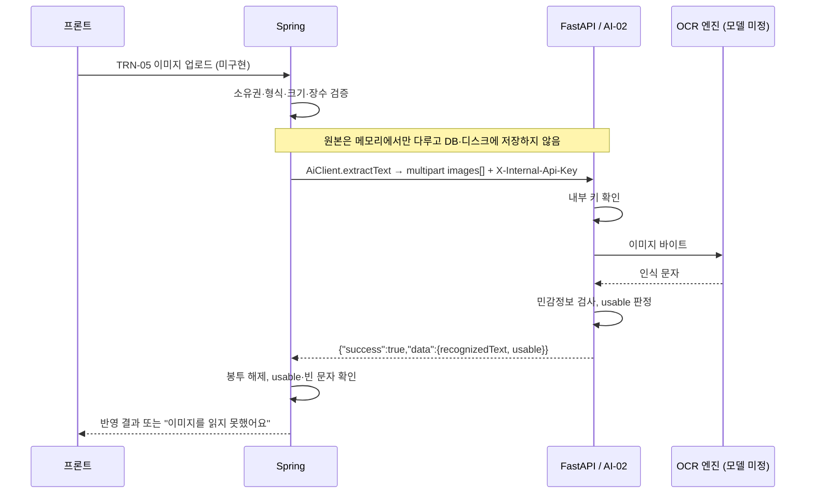
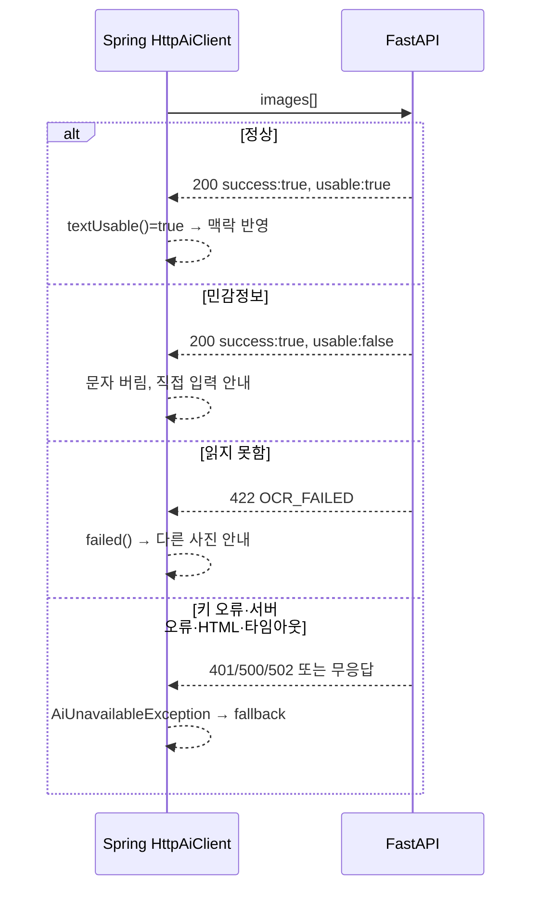

# AI-02 OCR 추출 개발·연결 설계

## 이 문서의 기준

AI-02(`POST /internal/ai/ocr/extract`)는 훈련 이미지에서 문자를 읽고 민감정보를 검사하는 **FastAPI 내부 API**예요. 사용자는 Spring에만 이미지를 올리고, Spring이 FastAPI를 불러요.

이 문서는 세 가지를 설명해요.

1. Spring 쪽을 **어떻게 개발했는지** (순서, 설계 결정과 이유, 만난 문제)
2. **무엇을 만들었는지** (파일과 핵심 코드)
3. **FastAPI 코드와 어떻게 주고받는지** (실제 HTTP 메시지, FastAPI 예시 코드, 경우별 처리)

| 구분 | 상태 |
|---|---|
| Spring 호출 클라이언트 `AiClient.extractText` | 구현. Fake·HTTP 어댑터, 가짜 HTTP 서버 계약 테스트 7개 |
| FastAPI `POST /internal/ai/ocr/extract` | 미구현. OCR 모델이 아직 없어요 |
| 업로드 API TRN-05 `POST /api/trainings/{id}/discovery/images` | 미구현. 지금은 `extractText`를 부르는 곳이 없어요 |
| 인식 문자를 AI-01 대화 맥락에 반영 | 미구현 |
| 실제 FastAPI와 통합 검증 | 미완료 |

아래 FastAPI 코드는 이 저장소에 없는 **예시 구조**예요. FastAPI를 만들 때 이 계약을 기준으로 삼고, 다르게 정하면 Spring 클라이언트와 이 문서를 함께 고쳐요.

관련 문서: [API 기준](api.md), [AI 패키지 README](../src/main/java/com/wsid/ai/README.md), [AI-01 연결 설계](ai-01-integration.md)

## 전체 연결



| 책임 | Spring | FastAPI |
|---|---|---|
| 사용자 로그인·훈련 소유권 확인 | O | X |
| 파일 형식·크기·장수 제한 | O (TRN-05) | 최소한의 방어만 |
| 문자 인식 | X | O |
| 민감정보 검사, `usable` 판정 | 결과만 따름 | O |
| 인식 문자 저장·AI-01 맥락 반영 결정 | O | X |
| 원본 이미지 보관 | 하지 않음 | 하지 않음 |

## 1. 어떻게 개발했나

### 개발 순서

[AI 패키지 README](../src/main/java/com/wsid/ai/README.md)의 "내부 API를 하나 추가하는 방법" 순서를 그대로 따랐어요.

1. **명세 확인**: 요청 `multipart/form-data: images(File[])`, 응답 `{"success":true,"data":{"recognizedText","usable"}}`, 오류 `OCR_FAILED`, 검증 포인트 "원본 임시 보관 제한, OCR 실패 처리, 외부 직접 호출 금지".
2. **DTO 작성**: 보낼 이미지 `OcrImage`, 받을 결과 `OcrExtractResult`, 공통 응답 봉투 `AiEnvelope<T>`.
3. **인터페이스 추가**: `AiClient.extractText(List<OcrImage>)`.
4. **Fake 구현**: FastAPI 없이 화면·서비스를 먼저 개발할 수 있도록 `FakeAiClient`에 고정 응답을 넣었어요.
5. **HTTP 구현**: `HttpAiClient`에 multipart 전송, 봉투 해제, 실패 분류를 넣었어요.
6. **계약 테스트**: JDK 내장 HTTP 서버를 FastAPI 대신 띄워 실제 HTTP로 성공·실패 응답을 확인했어요.
7. **문서**: `docs/api.md` 상태, AI README 계약 절, 이 문서.

호출하는 서비스(TRN-05)는 업로드 API·파일 검증·소유권 확인이 함께 필요한 별도 작업이라 이번 범위에서 뺐어요.

### 설계 결정과 이유

| 결정 | 이유 |
|---|---|
| `OCR_FAILED`는 예외가 아니라 결과(`OcrExtractResult.failed()`)로 돌려줘요 | 흐린 사진처럼 **사용자 입력 때문에** 읽지 못한 경우예요. 서버 장애(`AiUnavailableException`)와 구분해야 화면이 "다른 사진을 올려 주세요"로 안내할 수 있어요 |
| 응답을 `retrieve()`가 아니라 `exchange()`로 읽어요 | `retrieve()`는 4xx·5xx에서 본문을 보기 전에 예외를 던져요. FastAPI가 `OCR_FAILED`를 422로 보내도 본문의 `error.code`를 확인하려면 상태 코드와 상관없이 본문을 읽어야 해요 |
| 범용 봉투 `AiEnvelope<T>`를 새로 만들었어요 | AI-01의 `DiscoveryEnvelope`는 AI-01 필드 검사에 묶여 있어요. AI-03 이후도 같은 `{"success","data","error"}` 형식을 쓰니 제네릭으로 두었어요 |
| `usable=false`면 문자를 쓰지 않고, `usable=true`여도 빈 문자는 쓰지 않아요 (`textUsable()`) | 민감정보 판정은 FastAPI가 하지만 최종 사용 여부는 Spring이 정해요. "AI는 제안만 한다"는 패키지 규칙과 같아요 |
| `OcrImage`·`OcrExtractResult`의 `toString`을 바꿨어요 | record 기본 `toString`은 모든 필드를 출력해요. 디버그 로그 한 줄로 이미지 바이트나 전화번호가 남지 않도록 길이만 출력해요 |
| 예외에 원인(cause)을 붙이지 않아요 | Spring HTTP 예외 메시지에 응답 본문이 들어갈 수 있어요. AI-01의 `suggestDiscovery`와 같은 규칙이에요 |
| 파일 이름·형식이 없으면 기본값(`image-1`, `application/octet-stream`)을 넣어요 | FastAPI `UploadFile`은 파일 이름이 없는 파트를 파일로 인식하지 않을 수 있어요 |
| 이미지를 바이트 배열로 받아요 (`MultipartFile` 아님) | `ai` 패키지가 웹 계층 타입에 묶이지 않게 했어요. TRN-05에서 `MultipartFile.getBytes()`로 바꿔 넘기면 돼요 |

### 개발 중 만난 문제

- **`MultipartBodyBuilder` 사용 시 `NoClassDefFoundError: org/reactivestreams/Publisher`**: 이 빌더는 reactive 라이브러리가 필요한데, 프로젝트는 Spring MVC만 써요. 테스트 6개가 실패해서 `LinkedMultiValueMap`에 파트마다 `HttpEntity`(Content-Disposition·Content-Type 헤더 포함)를 넣는 방식으로 바꿨어요. 의존성을 늘리지 않으려고 이 방법을 골랐어요.
- **AI-01 작업과 충돌**: 같은 브랜치에 AI-01 커밋이 먼저 푸시돼 있었어요. 리베이스하면서 `AiClient`·`FakeAiClient`·문서는 두 기능을 모두 남겼고, AI-01 생성자 구조(`RestClient.Builder` 주입)를 그대로 썼어요. 예외 원인 미보관 규칙도 AI-01에 맞췄어요.

## 2. 무엇을 만들었나

| 파일 | 역할 |
|---|---|
| [AiClient](../src/main/java/com/wsid/ai/AiClient.java) | `OcrExtractResult extractText(List<OcrImage> images)` |
| [HttpAiClient](../src/main/java/com/wsid/ai/HttpAiClient.java) | multipart 생성(`toMultipart`), 호출(`extractText`), 봉투 해제·실패 분류(`unwrap`) |
| [FakeAiClient](../src/main/java/com/wsid/ai/FakeAiClient.java) | `wsid.ai.mode=fake`용. 항상 `usable=true` 고정 문구, 파일 이름에 `ocr-fail`이 있으면 실패 결과 |
| [OcrImage](../src/main/java/com/wsid/ai/dto/OcrImage.java) | 보낼 이미지 `(filename, contentType, content)`. 바이트 null 금지 |
| [OcrExtractResult](../src/main/java/com/wsid/ai/dto/OcrExtractResult.java) | 응답 data `(recognizedText, usable)`, `failed()`, `textUsable()` |
| [AiEnvelope](../src/main/java/com/wsid/ai/dto/AiEnvelope.java) | `{"success","data","error":{"code","message"}}`, 모르는 필드 무시 |
| [HttpAiClientOcrTest](../src/test/java/com/wsid/ai/HttpAiClientOcrTest.java) | 가짜 FastAPI 서버로 계약 테스트 |

DB 테이블은 바꾸지 않았어요. 원본 이미지와 인식 문자를 저장하는 컬럼도 만들지 않았어요.

### 핵심 코드 흐름 (`HttpAiClient.extractText`)

```java
AiEnvelope<OcrExtractResult> envelope = restClient.post()
        .uri("/internal/ai/ocr/extract")               // baseUrl = AI_BASE_URL
        .contentType(MediaType.MULTIPART_FORM_DATA)    // X-Internal-Api-Key는 기본 헤더로 붙어요
        .body(toMultipart(images))                     // 파트 이름 "images"로 여러 장
        .exchange((request, response) -> response.bodyTo(OCR_RESPONSE)); // 상태 코드와 상관없이 본문 읽기
return unwrap(envelope);
```

`unwrap`의 판단 순서:

1. 봉투가 없음 → `AiUnavailableException`
2. `success=false`이고 `error.code == "OCR_FAILED"` → `OcrExtractResult.failed()` (`recognizedText=null`, `usable=false`)
3. `success=false`이고 다른 코드 → `AiUnavailableException`
4. `success=true`인데 `data` 없음 → `AiUnavailableException`
5. 그 밖에는 `data`를 그대로 반환

JSON이 아닌 본문, 연결 실패, 타임아웃(연결 2초, 응답 20초)도 `AiUnavailableException`이에요.

### 앞으로 TRN-05에서 부르는 방법 (예시)

```java
List<OcrImage> images = files.stream()
        .map(f -> new OcrImage(f.getOriginalFilename(), f.getContentType(), f.getBytes()))
        .toList();
try {
    OcrExtractResult result = aiClient.extractText(images);   // 트랜잭션 밖에서 호출
    if (result.textUsable()) {
        // AI-01 맥락에 반영 (저장 방식은 TRN-05에서 결정)
    } else {
        // OCR_FAILED 또는 민감정보: 문자를 버리고 다른 사진 또는 직접 입력 안내
    }
} catch (AiUnavailableException e) {
    // AI 장애: 직접 입력 안내 (fallback)
}
```

## 3. FastAPI와 어떻게 주고받나

### Spring이 실제로 보내는 HTTP 요청

```http
POST /internal/ai/ocr/extract HTTP/1.1
Host: <AI_BASE_URL의 호스트>
X-Internal-Api-Key: <AI_API_KEY>
Content-Type: multipart/form-data; boundary=<임의 경계>

--<경계>
Content-Disposition: form-data; name="images"; filename="chat.png"
Content-Type: image/png

<이미지 바이트>
--<경계>
Content-Disposition: form-data; name="images"; filename="image-2"
Content-Type: application/octet-stream

<이미지 바이트>
--<경계>--
```

- 파트 이름은 **모두 `images`**예요. FastAPI에서는 `images: list[UploadFile] = File(...)`로 받으면 같은 이름 파트가 리스트로 모여요.
- 이미지 순서는 Spring이 넘긴 순서 그대로예요.

### FastAPI가 돌려줘야 하는 응답

| 상황 | HTTP 상태 | 본문 | Spring 결과 |
|---|---|---|---|
| 정상, 민감정보 없음 | 200 | `{"success":true,"data":{"recognizedText":"거래 관련 안내","usable":true}}` | 결과 반환, `textUsable()=true` |
| 정상, 민감정보 있음 | 200 | `{"success":true,"data":{"recognizedText":"","usable":false}}` | 결과 반환, 문자 사용 안 함 |
| 문자를 읽지 못함 | 422 (권장) | `{"success":false,"error":{"code":"OCR_FAILED","message":"..."}}` | `OcrExtractResult.failed()` |
| 내부 키 오류 | 401 | `{"success":false,"error":{"code":"UNAUTHORIZED",...}}` | `AiUnavailableException` |
| 이미지 없음·형식 오류 | 400 | `{"success":false,"error":{"code":"INVALID_REQUEST",...}}` | `AiUnavailableException` |
| 서버 내부 오류 | 500 | `{"success":false,"error":{"code":"INTERNAL_ERROR",...}}` | `AiUnavailableException` |

- 필드 이름은 **camelCase**(`recognizedText`)예요. Pydantic 필드를 snake_case로 쓰면 alias를 지정해요.
- `OCR_FAILED`는 상태 코드와 상관없이 본문 코드로 판단해요. 그래도 200이 아닌 422처럼 오류 상태로 보내는 걸 권장해요.
- 실패 본문 형식(`error.code`, `error.message`)은 **가정이라 확정이 필요해요**. AI-01도 같은 형식을 가정하고 있어요.

### FastAPI 예시 코드

계약에 맞춘 최소 구현 예시예요. 모델이 없는 지금은 `FakeOcrEngine`으로 Spring과 HTTP 연결부터 확인하고, 모델이 정해지면 `OcrEngine` 구현만 바꾸면 돼요. 경로·파일 이름은 AI-01 문서의 제안 구조(`app/...`)와 맞췄어요.

`app/core/errors.py`: 실패 봉투를 만드는 공통 예외

```python
from fastapi import Request
from fastapi.responses import JSONResponse


class AiError(Exception):
    def __init__(self, status: int, code: str, message: str):
        self.status, self.code, self.message = status, code, message


async def ai_error_handler(request: Request, exc: AiError) -> JSONResponse:
    return JSONResponse(
        status_code=exc.status,
        content={"success": False, "error": {"code": exc.code, "message": exc.message}},
    )
```

`app/dependencies/internal_auth.py`: Spring의 `X-Internal-Api-Key` 확인

```python
import hmac
from fastapi import Header
from app.core.config import settings
from app.core.errors import AiError


async def verify_internal_key(x_internal_api_key: str | None = Header(default=None)) -> None:
    if x_internal_api_key is None or not hmac.compare_digest(x_internal_api_key, settings.internal_api_key):
        raise AiError(401, "UNAUTHORIZED", "내부 인증에 실패했어요.")
```

`app/schemas/ocr.py`: Spring `AiEnvelope<OcrExtractResult>`와 같은 모양

```python
from pydantic import BaseModel


class OcrExtractData(BaseModel):
    recognizedText: str
    usable: bool


class OcrExtractResponse(BaseModel):
    success: bool = True
    data: OcrExtractData
```

`app/services/ocr_engine.py`: 모델을 바꿔 끼우는 자리

```python
from typing import Protocol


class OcrEngine(Protocol):
    def read_text(self, image: bytes) -> str:
        """읽지 못하면 빈 문자열을 돌려줘요."""


class FakeOcrEngine:
    """모델이 정해지기 전 연결 확인용."""

    def read_text(self, image: bytes) -> str:
        return "거래 관련 안내" if image else ""
```

`app/services/sensitive_filter.py`: 민감정보 검사

```python
import re
from dataclasses import dataclass

PATTERNS = [
    re.compile(r"01[016789][-\s]?\d{3,4}[-\s]?\d{4}"),        # 휴대전화
    re.compile(r"\d{6}[-\s]?[1-4]\d{6}"),                       # 주민등록번호
    re.compile(r"\d{4}[-\s]?\d{4}[-\s]?\d{4}[-\s]?\d{4}"),     # 카드번호
    re.compile(r"\d{2,6}-\d{2,6}-\d{2,6}(-\d{1,4})?"),         # 계좌번호 형태
]


@dataclass
class SensitiveCheck:
    text: str
    usable: bool


def inspect(text: str) -> SensitiveCheck:
    if any(p.search(text) for p in PATTERNS):
        # 민감정보가 있으면 문자를 돌려주지 않아요. 가린 문자를 돌려줄지는 팀에서 확정해요.
        return SensitiveCheck(text="", usable=False)
    return SensitiveCheck(text=text, usable=True)
```

`app/routers/ocr.py`: 엔드포인트

```python
from fastapi import APIRouter, Depends, File, UploadFile
from fastapi.concurrency import run_in_threadpool

from app.core.errors import AiError
from app.dependencies.internal_auth import verify_internal_key
from app.schemas.ocr import OcrExtractData, OcrExtractResponse
from app.services import sensitive_filter
from app.services.ocr_engine import FakeOcrEngine

router = APIRouter(prefix="/internal/ai/ocr", dependencies=[Depends(verify_internal_key)])
ocr_engine = FakeOcrEngine()  # 모델이 정해지면 교체


@router.post("/extract", response_model=OcrExtractResponse)
async def extract(images: list[UploadFile] = File(...)) -> OcrExtractResponse:
    if not images:
        raise AiError(400, "INVALID_REQUEST", "이미지가 필요해요.")
    texts: list[str] = []
    for image in images:
        try:
            content = await image.read()
            # OCR은 CPU 작업이라 이벤트 루프를 막지 않게 스레드에서 실행해요.
            texts.append(await run_in_threadpool(ocr_engine.read_text, content))
        except Exception:
            # 원본·인식 문자를 로그에 남기지 않아요.
            raise AiError(422, "OCR_FAILED", "이미지에서 문자를 읽지 못했어요.")
        finally:
            await image.close()  # 업로드 임시 파일 정리
    text = "\n".join(t for t in texts if t).strip()
    if not text:
        raise AiError(422, "OCR_FAILED", "이미지에서 문자를 읽지 못했어요.")
    check = sensitive_filter.inspect(text)
    return OcrExtractResponse(data=OcrExtractData(recognizedText=check.text, usable=check.usable))
```

`app/main.py`: 등록

```python
from fastapi import FastAPI
from app.core.errors import AiError, ai_error_handler
from app.routers import ocr

app = FastAPI()
app.add_exception_handler(AiError, ai_error_handler)
app.include_router(ocr.router)  # 최종 경로: /internal/ai/ocr/extract
```

FastAPI 구현 때 확인할 점:

- multipart를 받으려면 `python-multipart` 패키지가 필요해요.
- Starlette `UploadFile`은 일정 크기(기본 1MB)를 넘으면 임시 파일로 디스크에 쓰고, `close()` 때 지워요. "원본 임시 보관 제한"을 지키려면 `finally`에서 꼭 닫고, 크기 상한은 Spring(TRN-05)에서 먼저 막아요.
- 인증 실패·OCR 실패·서버 오류를 성공(200)으로 꾸미지 않아요. Spring은 봉투의 `success`와 `error.code`로 판단해요.
- 요청·응답 본문, 인식 문자를 로그에 남기지 않아요.
- FastAPI 포트를 외부에 공개하지 않아요. 내부 키와 함께 네트워크로도 막아야 "외부 사용자 직접 호출 금지"가 지켜져요.

### 경우별 흐름



## 실행과 연결 순서

| 설정 | 쓰는 곳 | 확인 |
|---|---|---|
| `AI_MODE` | `AiClientConfig` | `fake`면 FastAPI를 부르지 않아요. 연결할 때는 `http` |
| `AI_BASE_URL` | `HttpAiClient` baseUrl | Spring에서 접근 가능한 FastAPI 주소. 경로는 클라이언트가 붙여요 |
| `AI_API_KEY` | `X-Internal-Api-Key` 헤더 | FastAPI `settings.internal_api_key`와 같아야 해요. Git에 넣지 않아요 |

1. 지금은 `AI_MODE=fake`로 개발해요. 파일 이름에 `ocr-fail`을 넣으면 실패 흐름을 확인할 수 있어요.
2. FastAPI에 위 예시처럼 `FakeOcrEngine`으로 엔드포인트를 먼저 만들고, 직접 호출해 봐요.

   ```bash
   curl -X POST http://localhost:8000/internal/ai/ocr/extract -H 'X-Internal-Api-Key: local-dev-key' -F 'images=@sample.png' -F 'images=@sample2.png'
   ```

3. Spring을 `AI_MODE=http`, `AI_BASE_URL`, `AI_API_KEY`로 띄워 두 서버 연결을 확인해요(TRN-05가 생기면 그 API로).
4. OCR 모델을 정해 `OcrEngine` 구현만 바꾸고, 정상·민감정보·흐린 사진·여러 장 사례를 다시 확인해요.

## 테스트

`./gradlew test`로 돌아가요. DB가 필요 없어요.

[HttpAiClientOcrTest](../src/test/java/com/wsid/ai/HttpAiClientOcrTest.java)는 JDK 내장 HTTP 서버(`com.sun.net.httpserver.HttpServer`)를 `/internal/ai/ocr/extract`에 띄워 FastAPI 역할을 시켜요. 받은 요청 헤더·본문을 저장해 두고, 테스트마다 정해 둔 상태 코드·본문을 돌려줘요.

| 테스트 | 가짜 서버 응답 | 확인하는 것 |
|---|---|---|
| 성공 | 200, `usable:true` | data 추출, multipart 형식, `images` 파트 2장, 기본 파일 이름 `image-2`, 이미지 형식, 내부 키 헤더 |
| 민감정보 | 200, `usable:false` | `usable=false` 전달, `textUsable()=false` |
| `OCR_FAILED` | 422 | 예외 없이 `failed()` |
| 다른 오류 코드 | 500 | `AiUnavailableException` |
| HTML 본문 | 502 | `AiUnavailableException` |
| `data` 없음 | 200, `{"success":true}` | `AiUnavailableException` |
| 로그 노출 | - | `toString`에 전화번호 같은 인식 문자 미포함 |

결과: AI-01 테스트를 포함해 전체 50개 통과. 가짜 서버 응답은 이 문서의 가정 계약이라, 실제 FastAPI와 맞춰 보는 테스트는 아직 없어요.

## 변경할 때 함께 볼 곳

| 바꾸는 것 | 함께 고칠 곳 | 테스트 |
|---|---|---|
| 경로, 파트 이름 `images`, 내부 키 헤더 | `HttpAiClient`, FastAPI `routers/ocr.py`, `internal_auth.py` | `HttpAiClientOcrTest` 성공 케이스 |
| 응답 필드(`recognizedText`, `usable`) | `OcrExtractResult`, FastAPI `schemas/ocr.py` | 성공·민감정보 케이스 |
| 실패 봉투·`OCR_FAILED` 코드 | `AiEnvelope`, `HttpAiClient.unwrap`, FastAPI `errors.py` | 실패 케이스 3개 |
| 민감정보 기준 | FastAPI `sensitive_filter.py` (Spring은 `usable`만 따름) | FastAPI 쪽 단위 테스트 필요 |

## 남은 작업과 정할 것

1. OCR 모델 선정, FastAPI AI-02 구현
2. 실패 봉투 형식 확정 (AI-01과 공통)
3. 민감정보가 걸렸을 때 `recognizedText`를 비울지, 가린 문자로 돌려줄지
4. TRN-05 업로드 API: 소유권 확인, 형식·크기·장수 제한, `extractText` 호출, 결과를 AI-01 맥락에 반영하는 방식
5. `AI_MODE=http`로 실제 FastAPI와 통합 검증
