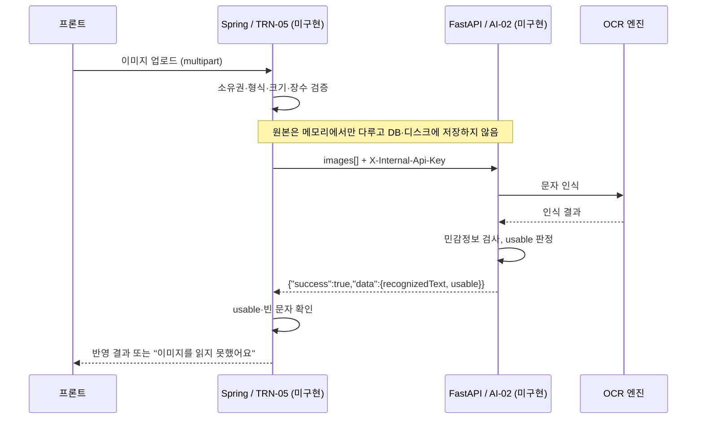

# AI-02 OCR 추출 연결 설계

## 이 문서의 기준

AI-02는 훈련 이미지에서 문자를 읽고 민감정보를 검사하는 **FastAPI 내부 API**예요. 이 저장소에는 그 API를 부르는 Spring 쪽 클라이언트만 있어요.

| 구분 | 상태 |
|---|---|
| Spring 호출 클라이언트 (`AiClient.extractText`) | 구현. Fake·HTTP 어댑터와 가짜 HTTP 서버 계약 테스트 |
| FastAPI `POST /internal/ai/ocr/extract` | 미구현. OCR 모델이 아직 없어요 |
| 업로드 API TRN-05 `POST /api/trainings/{id}/discovery/images` | 미구현. 지금은 `extractText`를 부르는 곳이 없어요 |
| 인식한 문자를 AI-01 대화 맥락에 반영 | 미구현 |
| 실제 FastAPI와의 통합 검증 | 미완료 |

아래 FastAPI 파일 이름과 실패 응답 형식은 **제안·가정**이에요. FastAPI를 만들 때 이 문서와 Spring 클라이언트를 함께 맞춰요.

관련 문서: [API 기준](api.md), [AI 패키지 README](../src/main/java/com/wsid/ai/README.md), [AI-01 연결 설계](ai-01-integration.md)

## 전체 연결 (목표)



브라우저는 FastAPI를 직접 부르지 않아요. AI-02는 Spring만 호출하는 내부 API이고, 외부 사용자의 직접 호출은 금지예요.

## HTTP 계약

### 요청

- `POST /internal/ai/ocr/extract`
- `Content-Type: multipart/form-data`
- 헤더 `X-Internal-Api-Key`: 서버 간 인증. 값은 `AI_API_KEY` 설정이에요.
- 파트 `images`: 이미지 파일 여러 장. 파일 이름이 없으면 Spring이 `image-1`, `image-2`…를 붙이고, 형식이 없으면 `application/octet-stream`으로 보내요.

### 성공 응답

```json
{"success": true, "data": {"recognizedText": "거래 관련 안내", "usable": true}}
```

| 필드 | 의미 | Spring 처리 |
|---|---|---|
| `recognizedText` | 이미지에서 읽은 문자 | 로그에 남기지 않음 |
| `usable` | 민감정보 검사를 통과해 맥락으로 써도 되는지 | `false`면 문자를 저장하거나 다음 AI 요청에 넣지 않음 |

`usable=true`여도 문자가 비어 있으면 쓰지 않아요(`OcrExtractResult.textUsable()`).

### 실패 응답 (가정, 확정 필요)

```json
{"success": false, "error": {"code": "OCR_FAILED", "message": "문자를 읽지 못했어요."}}
```

| 받은 응답 | Spring 결과 |
|---|---|
| `error.code = OCR_FAILED` (상태 코드 무관) | 예외 없이 `OcrExtractResult.failed()` → 화면은 "이미지를 읽지 못했어요" |
| 다른 오류 코드 | `AiUnavailableException` |
| `success:true`인데 `data` 없음 | `AiUnavailableException` |
| JSON이 아닌 본문 (프록시 오류 페이지 등) | `AiUnavailableException` |
| 연결 실패·타임아웃 (연결 2초, 응답 20초) | `AiUnavailableException` |

예외 메시지에 응답 본문이 섞일 수 있어 원인 예외를 붙이지 않아요. AI-01과 같은 방식이에요.

## Spring 파일

| 파일 | 역할 |
|---|---|
| [AiClient](../src/main/java/com/wsid/ai/AiClient.java) | `extractText(List<OcrImage>)` 인터페이스 |
| [HttpAiClient](../src/main/java/com/wsid/ai/HttpAiClient.java) | multipart 요청 생성, 응답 봉투 해제, 실패 분류 |
| [FakeAiClient](../src/main/java/com/wsid/ai/FakeAiClient.java) | `wsid.ai.mode=fake`용 고정 응답. 파일 이름에 `ocr-fail`이 있으면 실패 결과 |
| [OcrImage](../src/main/java/com/wsid/ai/dto/OcrImage.java) | 보낼 이미지(이름·형식·바이트). `toString`에 바이트를 출력하지 않음 |
| [OcrExtractResult](../src/main/java/com/wsid/ai/dto/OcrExtractResult.java) | 응답 data. `toString`에 인식 문자 대신 길이만 출력 |
| [AiEnvelope](../src/main/java/com/wsid/ai/dto/AiEnvelope.java) | 범용 `{"success","data","error"}` 봉투. AI-01은 별도 `DiscoveryEnvelope`를 써요 |

DB 테이블 변경은 없어요. 원본 이미지와 인식 문자를 저장하는 컬럼도 만들지 않았어요.

## FastAPI 쪽에서 필요한 역할 (제안 구조)

| 제안 파일 | 역할 |
|---|---|
| `routers/ocr.py` | `POST /internal/ai/ocr/extract`, `images: list[UploadFile]`, 내부 키 확인 |
| `services/ocr_engine.py` | OCR 모델 호출. 모델이 정해지면 교체할 수 있게 인터페이스로 분리 |
| `services/sensitive_filter.py` | 전화번호·계좌·주민등록번호·카드번호 등 검사, `usable` 판정 |
| `schemas/ocr.py` | 응답 `recognizedText`, `usable`과 성공·실패 봉투 |

FastAPI 구현 때 지킬 것:

- 원본은 요청 처리 동안 메모리에서만 다루고 디스크·로그에 남기지 않아요. 임시 파일이 필요하면 처리 직후 지워요.
- 인식 실패는 `OCR_FAILED`로 돌려주고, 서버 오류와 구분해요.
- 민감정보가 걸렸을 때 `recognizedText`를 비울지, 가린 문자를 돌려줄지는 함께 정해야 해요. Spring은 `usable=false`면 어느 쪽이든 쓰지 않아요.

## 테스트

`./gradlew test`로 돌아가요. DB가 필요 없어요.

[HttpAiClientOcrTest](../src/test/java/com/wsid/ai/HttpAiClientOcrTest.java)는 JDK 내장 HTTP 서버를 FastAPI 대신 띄워 실제 HTTP로 호출해요.

| 테스트 | 확인하는 것 |
|---|---|
| 성공 | data 추출, `images` 파트 2장, 기본 파일 이름, 내부 키 헤더 |
| 민감정보 | `usable=false` 전달 |
| `OCR_FAILED` (422) | 예외 없이 실패 결과 |
| 다른 오류 코드 (500) | `AiUnavailableException` |
| HTML 본문 (502) | `AiUnavailableException` |
| `data` 없음 | `AiUnavailableException` |
| 로그 노출 | `toString`에 인식 문자 미포함 |

가짜 서버의 응답은 이 문서의 가정 계약이에요. 실제 FastAPI와 맞춰 보는 테스트는 아직 없어요.

## 남은 작업

1. FastAPI AI-02 구현 (OCR 모델 선정 후)
2. 실패 응답 형식과 민감정보가 걸렸을 때의 `recognizedText` 처리 확정
3. TRN-05 업로드 API: 소유권 확인, 형식·크기·장수 제한, `extractText` 호출, 결과를 AI-01 맥락에 반영
4. `AI_MODE=http`로 실제 FastAPI와 통합 검증
