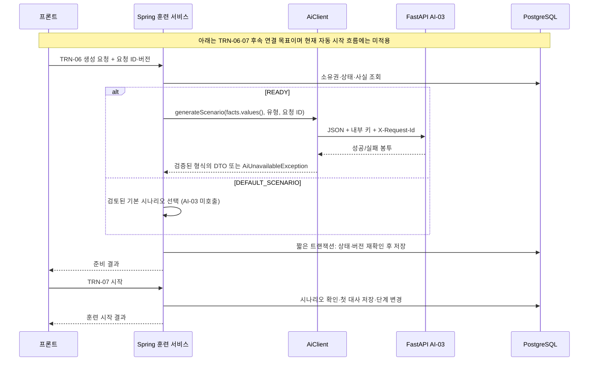

# AI-03 시나리오 생성 구현·연결 안내

작성일: 2026-11-16 · Spring 1차 구현 완료

## 1. 구현 결과와 현재 동작

AI-03은 상황 파악에서 얻은 사실을 FastAPI에 보내 훈련 시나리오의 개요와 모의 페이지 코드를 받는 내부 호출이다. 이번에는 [구현 계획서](ai-03-scenario-plan.md)의 **1차 범위**를 구현했다.

| 구분 | 현재 상태 |
|---|---|
| `AiClient.generateScenario()` | 구현 |
| 요청 DTO 검증·정규화·복사 | 구현 |
| 개발용 fake | 구현. 알려진 구매자·판매자 역할에 따른 고정 가상 설명 |
| FastAPI HTTP 호출·응답 타입 검사 | 구현 |
| 요청 ID·내부 키 전달 | 구현 |
| AI-03 전용 응답 제한 | 구현. 기본 20초, 별도 설정 가능 |
| 테스트 | 신규 59개, 기존 포함 109개 통과 |
| 실제 FastAPI·LLM | 이 저장소에 없음. 실제 서버와의 통합 검증은 미완료 |
| 훈련 서비스에서 AI-03 호출·DB 저장 | 후속 TRN-06 작업. 현재 호출하지 않음 |
| 훈련 시작 분리·모의 페이지 표시 | 후속 TRN-07·09 작업 |

따라서 현재 사용자가 훈련을 진행하면 기존처럼 상황 파악을 여러 번 수행한 뒤 고정 유형과 첫 대사로 자동 시작한다. AI-03 클라이언트를 추가했다고 훈련 흐름이 자동으로 개인화되지는 않는다. DB 스키마나 기존 상황 파악·시작 규칙은 이번에 변경하지 않았다.

## 2. 어떤 코드를 만들었나

| 파일 | 구현 내용 |
|---|---|
| [ScenarioGenerateRequest](../src/main/java/com/wsid/ai/dto/ScenarioGenerateRequest.java) | FastAPI에 보낼 사실·유형 코드와 헤더용 요청 ID |
| [ScenarioGenerateResult](../src/main/java/com/wsid/ai/dto/ScenarioGenerateResult.java) | 응답 `data`, 중첩 `Scenario`, 제목·설명·템플릿 코드 형식 검증 |
| [AiClient](../src/main/java/com/wsid/ai/AiClient.java) | `generateScenario` 호출 계약 |
| [FakeAiClient](../src/main/java/com/wsid/ai/FakeAiClient.java) | FastAPI 없이 실행하는 개발용 결과 |
| [HttpAiClient](../src/main/java/com/wsid/ai/HttpAiClient.java) | 실제 HTTP 요청, JSON 타입 검사, 결과 변환, 실패 예외 변환 |
| [AiProperties](../src/main/java/com/wsid/ai/AiProperties.java) | 기존 설정과 `scenarioReadTimeout` |
| [AiClientConfig](../src/main/java/com/wsid/ai/AiClientConfig.java) | fake/HTTP 구현 선택, 분리된 HTTP 전송 설정 구성 경로 |
| [application.yml](../src/main/resources/application.yml) | `AI_SCENARIO_READ_TIMEOUT` 환경변수 연결 |

### DTO는 어디로 가나

요청 DTO는 FastAPI에 전송할 JSON을 만드는 데 사용한다. 응답 DTO는 FastAPI의 JSON을 Java 코드에서 다룰 수 있게 받는다. DTO 자체는 DB에 접근하지 않는다.

```text
호출자
  → ScenarioGenerateRequest 생성·검증
  → AiClient.generateScenario(request)
      ├─ fake: 개발용 ScenarioGenerateResult 생성
      └─ http: FastAPI 호출 → JsonNode 검사 → ScenarioGenerateResult 변환
  ← ScenarioGenerateResult 반환
  → 결과 저장·훈련 시작 여부는 호출자가 결정 (연결 미구현)
```

현재 이 메서드의 호출자는 테스트다. 운영 코드의 `TrainingService`에는 아직 AI-03 호출이 없다. 응답 DTO를 받는 것과 DB에 저장하는 것은 별도 작업이다.

## 3. 요청 계약과 입력 검증

```http
POST /internal/ai/scenarios/generate
Content-Type: application/json
X-Internal-Api-Key: <AI_API_KEY>
X-Request-Id: 11111111-1111-1111-1111-111111111111
```

```json
{
  "facts": {
    "activity": "중고거래",
    "role": "판매자"
  },
  "fraudTypeCode": "SECONDHAND_TRADE"
}
```

Java에서는 다음처럼 생성한다.

```java
var request = new ScenarioGenerateRequest(
        Map.of("activity", "중고거래", "role", "판매자"),
        "SECONDHAND_TRADE",
        requestId);
ScenarioGenerateResult result = aiClient.generateScenario(request);
```

| 항목 | 구현된 규칙 |
|---|---|
| `facts` | null·빈 Map 거부 |
| 허용 키 | `activity`, `role`, `channel`, `item`, `counterpart` |
| 잘못된 키 | null·허용 목록 밖의 키는 예외. 조용히 버리지 않음 |
| 사실 값 | 문자열. null·공백·앞뒤 공백 제거 후 100자 초과는 예외 |
| 정규화 | `strip()`으로 앞뒤 공백을 제거한 값을 새 Map에 담음 |
| 필수 사실 | `activity` 필수. AI-03 계약 자체에서는 `role` 생략 가능 |
| 유형 코드 | 현재 `SECONDHAND_TRADE`만 지원. null·빈 값·미지원 코드·다른 대소문자·앞뒤 공백 포함 코드는 거부 |
| 요청 ID | UUID 필수. `@JsonIgnore`로 본문에서 제외하고 헤더에만 전송 |
| 방어적 복사 | 정규화 후 `Map.copyOf()`로 보관. 원본 변경이 요청에 반영되지 않음 |

잘못된 입력은 DTO 생성 시 `IllegalArgumentException`이다. 로컬 입력 오류를 AI 장애로 감추지 않는다. null 요청을 `generateScenario`에 직접 넘겨도 입력 예외다.

`ScenarioGenerateRequest`는 `ContextFacts`를 import하지 않는다. 후속 훈련 서비스는 `session.getContextFacts().values()`를 넘기면 된다. 허용 키는 각 패키지에 선언하고 테스트에서 일치 여부를 확인한다. `ContextFacts.merge()`의 필터링 동작을 요청 검증에 사용하지 않는다.

### 요청 ID 처리

새 논리적 생성 요청에는 새 UUID를 사용하고, 같은 요청을 재시도할 때는 같은 UUID를 유지한다. 어댑터 내부에서는 자동 재시도하지 않는다. 호출자가 다시 요청하면 전달받은 ID를 그대로 사용한다.

이 헤더는 Spring·FastAPI의 호출을 추적하는 식별자다. 헤더만 추가해 중복 LLM 실행·중복 DB 저장이 방지되는 것은 아니다. TRN-06에서 별도 저장 상태·버전·중복 요청 정책을 구현해야 한다.

## 4. 응답을 어떻게 읽고 검사하나

정상 응답은 다음과 같다.

```json
{
  "success": true,
  "data": {
    "scenario": {
      "title": "중고거래 안전 확인 훈련",
      "description": "가상 거래 상황"
    },
    "mockPageTemplateCode": "BANK_NOTICE"
  }
}
```

`HttpAiClient.generateScenario()`의 순서:

1. AI-03용 `scenarioRestClient`로 요청한다.
2. 응답을 `JsonNode`로 받는다.
3. 최상위 객체와 `success`의 실제 boolean 타입·`true` 값을 확인한다.
4. `data`, `data.scenario`가 객체인지 확인한다.
5. `title`, `description`, `mockPageTemplateCode`가 실제 문자열인지 확인한다.
6. `treeToValue(data, ScenarioGenerateResult.class)`로 `data`만 DTO로 변환한다.
7. DTO 생성자에서 문자열 길이·공백·코드 형식을 검사한다.
8. 검사를 통과한 `ScenarioGenerateResult`를 반환한다.

아래는 메서드 내부에서 발췌한 처리 순서다. 생략된 검사를 포함한 전체 코드는 `HttpAiClient.generateScenario()`에 있다.

```text
// 실제 구현의 핵심 순서
JsonNode node = scenarioRestClient.post()
        .uri(SCENARIO_PATH)
        .contentType(MediaType.APPLICATION_JSON)
        .header("X-Request-Id", request.requestId().toString())
        .body(request).retrieve().body(JsonNode.class);

// success·data·scenario·문자열의 JSON 타입을 먼저 검사한 후:
return SCENARIO_JSON.treeToValue(node.path("data"), ScenarioGenerateResult.class);
```

`AiEnvelope`는 AI-02에서 사용하던 공통 봉투 DTO이며 이번에도 그대로 남아 있다. AI-03은 이 객체로 직접 역직렬화하지 않는다. 원본 JSON을 먼저 검사하기 때문에 `"success":"true"`가 자동으로 boolean으로 바뀌어 통과하지 않는다. 이 변경을 AI-02까지 일괄 적용하지는 않았다.

| 필드 | 결과 DTO의 규칙 |
|---|---|
| `scenario` | null 불가 |
| `title` | 공백 불가, 최대 100자 |
| `description` | 공백 불가, 최대 1,000자 |
| `mockPageTemplateCode` | `[A-Z0-9_]{1,50}` |
| 알 수 없는 추가 필드 | 사용하지 않고 무시 |

제목·설명의 길이는 Java의 `String.length()` 기준이다. 수신 문자열을 잘라서 성공으로 바꾸지 않는다. 제목·설명은 받은 값을 유지하고, 사실 요청의 `strip()` 처리와 구분한다.

### 템플릿 코드는 어디까지 확인하나

1차는 형식만 검사한다. `UNREGISTERED_2`도 형식이 맞으면 결과로 받을 수 있다. 현재 카탈로그가 없으므로 실제 페이지가 존재하거나 해당 사기 유형에 맞는다는 보장은 없다.

2차 FastAPI는 등록·검토된 템플릿의 유형별 허용 여부를 확인해야 한다. 3차 Spring 저장에서도 실제 허용된 코드인지 다시 확인해야 한다. 화면 HTML·임의 URL을 LLM 결과로 받아 그대로 열지 않는다. `BANK_NOTICE`는 명세 예시와 fake의 개발용 값이며 실제 페이지를 제공한다는 뜻은 아니다.

## 5. 실패·개인정보·fake 동작

| 상황 | 현재 반환/예외 | 후속 호출자의 처리 |
|---|---|---|
| DTO 입력 오류 | `IllegalArgumentException` | 잘못된 유형 매핑·사실 전달을 수정. AI 장애로 취급하지 않음 |
| 정상 응답 | `ScenarioGenerateResult` | 콘텐츠·카탈로그 적합성 확인 후 저장 |
| 401·422·500·503 등 HTTP 오류 | `AiUnavailableException` | 검토된 기본 시나리오 또는 생성 불가 안내 |
| HTTP 200의 `success=false` | `AiUnavailableException` | 동일 |
| 잘못된 JSON·타입·누락·빈 값·길이 초과 | `AiUnavailableException` | 동일 |
| 네트워크 장애·응답 시간 초과 | `AiUnavailableException` | 동일 |

원본 HTTP/JSON 예외에는 응답 본문이 포함될 수 있어 AI-03에서는 원인 예외를 붙이지 않는다. AI 응답의 오류 메시지를 그대로 사용자에게 전달하거나 로그에 출력하지 않는다.

요청 DTO의 `toString()`은 키·지원 유형·요청 ID만 보여준다. 결과 DTO와 중첩 `Scenario`의 `toString()`은 제목·설명 대신 길이만 보여준다. 직렬화된 본문을 직접 로그에 출력하면 이 보호를 우회하므로 호출자도 본문 로깅을 하지 않아야 한다. 이 보호는 개인정보 감지·삭제 기능을 구현했다는 의미는 아니다.

fake는 `판매자`·`구매자`일 때 각각의 설명을 반환하고, role이 없거나 알려지지 않은 값이면 중립적인 중고거래 설명을 반환한다. 임의의 사실 원문·상대 이름·링크를 문장에 삽입하지 않는다. 같은 사실로 같은 결과를 만든다. LLM·검토 사례 카탈로그를 사용하는 구현은 아니며 운영용 대체 콘텐츠로 자동 채택해서는 안 된다.

## 6. 설정과 RestClient 상호작용

```yaml
wsid:
  ai:
    mode: ${AI_MODE:fake}
    base-url: ${AI_BASE_URL:http://localhost:8000}
    api-key: ${AI_API_KEY:local-dev-key}
    connect-timeout: 2s
    read-timeout: 20s
    scenario-read-timeout: ${AI_SCENARIO_READ_TIMEOUT:20s}
```

- `AI_MODE=fake`: 외부 서버에 연결하지 않는다.
- `AI_MODE=http`: `AiClientConfig`가 `new HttpAiClient(properties)`로 실제 구현을 만든다.
- AI-01·02·기존 AI-04는 `restClient`와 `readTimeout`을 사용한다.
- AI-03은 별도의 `scenarioRestClient`와 `scenarioReadTimeout`을 사용한다.
- 두 클라이언트는 같은 base URL·내부 키·연결 제한을 적용한다. 응답 제한만 별도로 조정한다.
- 예를 들어 `AI_SCENARIO_READ_TIMEOUT=45s`를 지정해도 다른 API의 응답 제한은 20초다. 45초는 설정 예시이며 운영 권장값이 아니다.
- 설정값이 누락되면 `AiProperties`는 기존 `readTimeout`으로 대체한다. `application.yml`의 기본값은 20초다. 0·음수는 거부한다.
- 기존 5개 인자 `AiProperties` 생성자는 유지했다. 이 방식은 AI-03에도 기존 `readTimeout`을 적용한다.

기존 `HttpAiClient(properties, builder)`는 테스트용 전송 주입을 유지하며 두 API 그룹이 주입한 빌더의 전송을 사용한다. `HttpAiClient(properties, builder, scenarioBuilder)`는 각각 별도 빌더를 주입할 수 있다. 커스텀 빌더를 직접 주입하는 호출자는 전송 시간 제한도 책임진다. 실제 Spring 설정 경로는 속성을 적용해 두 빌더를 각각 구성한다.

생성 대기 시간을 늘릴 때는 FastAPI의 LLM 처리 예산, 프론트와 프록시의 대기 제한도 맞춰야 한다. Spring의 요청 제한이 공급자 작업을 취소하거나 이미 실행한 LLM 호출 비용을 되돌리는 것은 아니다.

## 7. 상호작용하는 코드와 후속 처리

| 관련 코드 | 현재 역할 | AI-03 연결 시 할 일 |
|---|---|---|
| [TrainingController](../src/main/java/com/wsid/training/controller/TrainingController.java) | 상황 파악·훈련 메시지 등 공개 API | TRN-06 생성·TRN-07 시작 API와 DTO 계약 추가 |
| [TrainingService](../src/main/java/com/wsid/training/service/TrainingService.java) | AI-01 호출·사실 누적·저장, 준비 완료 시 임시 자동 시작 | 자동 시작 분리, READY에서 AI-03 호출, DEFAULT_SCENARIO에서는 검토된 기본 시나리오 선택 |
| [ContextFacts](../src/main/java/com/wsid/training/domain/ContextFacts.java) | 사실 필터링·누적 | `values()`만 DTO에 전달. AI DTO에서 역방향 import하지 않음 |
| [TrainingSession](../src/main/java/com/wsid/training/domain/TrainingSession.java) | 상태 규칙과 DB 엔티티 | 시나리오·템플릿 설정/조회 메서드, 저장 전 단계·활성 여부 검증 |
| [TrainingSessionRepository](../src/main/java/com/wsid/training/repository/TrainingSessionRepository.java) | 세션 조회·저장 | 저장 트랜잭션 안에서 상태·버전 재확인 후 결과 반영 |
| [TrainingMessageRepository](../src/main/java/com/wsid/training/repository/TrainingMessageRepository.java) | 메시지 이력과 메시지 요청 ID 확인 | TRN-07 첫 대사 중복 저장 방지. 메시지 ID 검사만으로 생성 멱등성을 대체하지 않음 |
| [SessionStateResponse](../src/main/java/com/wsid/training/dto/SessionStateResponse.java) | 이어하기의 대화·진행 상태 반환 | 저장한 시나리오 개요·준비 상태 복원 항목 추가 |
| [TrainingTurnRequest](../src/main/java/com/wsid/ai/dto/TrainingTurnRequest.java) | AI-04에 유형·턴·사용자 메시지 전달 | 사실·저장 시나리오·최근 대화 맥락 전달. AI-04 경로도 함께 정렬 |
| [ReviewedTexts](../src/main/java/com/wsid/training/service/ReviewedTexts.java)·[사례 YAML](../src/main/resources/content/scenarios/used-goods-seller.yml) | 기존 고정 문구·미검토 사례 초안 | 출처·검토·버전이 확인된 기본 시나리오와 첫 대사 제공 |
| FastAPI 스키마·라우터·생성 서비스 | 별도 저장소에서 개발 필요 | 아래 8장 계약에 맞춰 구현 |

### 상태와 호출 순서

여러 번 질문하는 기존 정책을 유지한다. 최소 답변 3회, 추가 질문 최대 5회이며, 필수 사실은 `activity`, `role`이다. 6번째 답변까지 받았을 때 필수 사실이 부족하면 `DEFAULT_SCENARIO`로 마친다.



AI-03 계약은 role 없는 직접 호출을 허용한다. 실제 훈련에서는 READY가 될 때 role을 확보하므로 역할 누락을 AI로 추측해 해결하지 않는다. DEFAULT_SCENARIO의 가상 역할을 사용자가 밝힌 사실에 합치지 않는다.

### 저장과 코드 호환성

| 응답/맥락 | 기존 DB 컬럼 | 처리 계획 |
|---|---|---|
| 확인된 사실 | `context_facts` | 현재 AI-01에서 저장. AI-03이 바꾸지 않음 |
| 요청 유형 | `fraud_type_code` | 기존 코드와의 표준화/매핑 후 저장 |
| `result.scenario()` | `scenario_json` | JSON 직렬화 후 엔티티를 통해 저장 |
| `result.mockPageTemplateCode()` | `mock_page_template_code` | 카탈로그 검증 후 함께 저장 |
| 버전 | `state_version` | 저장 직전 재확인·낙관적 잠금 |

DB 컬럼은 이미 있다. DTO를 Repository에 직접 저장하지 않고, 후속 엔티티 메서드에 값을 반영한다. 생성 호출은 트랜잭션 밖에서 하고, 호출 중 종료·만료·다른 요청의 갱신이 발생했으면 받은 결과를 저장하지 않는다. 이미 생성한 세션의 재요청에는 저장 결과 반환 정책을 마련한다. 생성 중복 요청의 식별과 동시 호출 비용 처리는 별도 설계가 필요하다.

현재 `TrainingService`와 YAML은 `USED_GOODS_TRADE`를 쓰고 새 요청은 `SECONDHAND_TRADE`만 받는다. 기존 값을 새 DTO에 그대로 넣으면 입력 예외가 발생한다. 후속 연결 때 명시적 경계 매핑을 만들거나 코드·콘텐츠를 함께 통일해야 한다. DB에 기존 값이 있는지도 조사해 새 Flyway 마이그레이션 또는 읽기 호환 매핑을 정한다. 이번에 기존 DB 값을 변경하지 않았다.

기본 시나리오는 검토 완료된 콘텐츠가 있을 때만 제공한다. 현재 `reviewed: false`인 YAML을 임의로 승인하거나 fake 결과로 성공을 꾸미지 않는다. 사용할 기본 콘텐츠도 없으면 생성 불가를 안내한다.

시나리오 응답의 제목·설명은 첫 대사·핵심 장면·평가 기준 전체가 아니다. 이 항목들은 검토된 콘텐츠와 조합하는 방법을 정해야 하며, 필요한 경우 AI 저장소와 응답 스키마를 확장한다. 현재 개요만 생성하는 계약으로 전체 개인화 훈련이 완성됐다고 보지 않는다.

## 8. FastAPI 개발 디렉토리에서 구현할 것

Python 파일은 이 저장소에 추가하지 않았다. 실제 AI 저장소의 구조에 맞춰 다음 책임을 구현한다.

| 제안 위치 | 구현 책임 |
|---|---|
| `schemas/scenario.py` | camelCase 요청·응답, 허용 키·길이·유형 코드, boolean success |
| `routers/scenarios.py` | 목표 POST 경로, 내부 키 확인, UUID 요청 ID 확인·전달, 성공 응답 구성 |
| 공통 오류 처리 | HTTP 실패 상태와 `success: false` 오류 봉투 반환 |
| `services/reviewed_scenario_catalog.py` | 검토 완료·출처·확인일·버전이 있는 사례와 허용 템플릿 제공 |
| `services/scenario_generator.py` | 사실·사례 선택, 구조화된 LLM 생성, 처리 시간 예산 |
| `services/scenario_validator.py` | 형식·사실 일치·유형별 템플릿·가상 훈련 한계 검증 |

`success`는 LLM에 생성시키지 않는다. FastAPI가 Python의 `True`·`False`로 응답하고, 실제 JSON에서도 boolean인지 테스트한다. 문자열 `"true"`·`"false"`를 반환하지 않는다.

FastAPI의 요청 DTO는 `requestId`를 본문에서 찾으면 안 된다. 헤더 `X-Request-Id`에서 읽어 추적한다. 내부 키가 맞는지 FastAPI에서 검증하고, 네트워크도 내부 통신으로 제한한다. Spring이 헤더를 보낸다는 사실만으로 서버 인증이 구현되는 것은 아니다.

사실은 프롬프트 지시와 구분하고 필요한 맥락만 전달한다. 가상 훈련·안전한 대응 연습 범위를 유지하며 실제 계좌·민감정보·유도 링크·실행 가능한 사기 절차를 생성하지 않도록 출력 검증과 내용 평가를 수행한다. 검토 사례가 없거나 결과를 검증하지 못하면 실패로 응답한다. Spring의 문자열 형식 검사만으로 콘텐츠 안전성이 보장되지 않는다.

실패 봉투의 예시는 다음과 같다. 생성 장애는 `503 + AI_SERVICE_UNAVAILABLE`를 제안하며 최종 상태·필드는 AI 담당자와 확정한다. Spring은 오류 코드별 내용을 사용자에게 노출하지 않고 사용 불가 예외로 변환한다.

```json
{
  "success": false,
  "error": {
    "code": "AI_SERVICE_UNAVAILABLE",
    "message": "훈련 시나리오를 생성하지 못했어요."
  }
}
```

## 9. 검증 결과와 실행 방법

2026-11-16에 Java 21 환경에서 `./gradlew test --no-daemon`을 실행했다. **109개, 실패 0개·오류 0개·건너뜀 0개**다. DB 태그 테스트는 기본 작업에서 제외된다.

| 신규 테스트 | 개수 | 검증 내용 |
|---|---|---|
| [ScenarioGenerateRequestTest](../src/test/java/com/wsid/ai/ScenarioGenerateRequestTest.java) | 18 | 키 목록 일치, 활동 필수, 입력 거부, 정규화·복사, 유형 호환성, 원문 비노출 |
| [FakeAiClientScenarioTest](../src/test/java/com/wsid/ai/FakeAiClientScenarioTest.java) | 2 | 역할별 설명·결정성·중립 동작·원문 재출력 방지 |
| [HttpAiClientScenarioTest](../src/test/java/com/wsid/ai/HttpAiClientScenarioTest.java) | 35 | 헤더·JSON, requestId 본문 제외, 재전달, 타입·길이·형식, 실패·타임아웃 |
| [ScenarioClientConfigurationTest](../src/test/java/com/wsid/ai/ScenarioClientConfigurationTest.java) | 4 | 속성 바인딩·모드 선택·시간 제한 검증·실제 HTTP의 API별 타임아웃 분리 |

HTTP 계약은 기존 AI-01처럼 `MockRestServiceServer`를 사용했다. 설정 테스트는 JDK 내장 HTTP 서버를 localhost의 임의 포트에서 실행해 **실제 Java HTTP 전송**도 검증했다. AI-03 제한이 AI-01보다 짧을 때와 길 때를 각각 확인했고, 내부 키·요청 ID·본문도 수신해 확인했다. 두 경우 모두 AI-01의 제한은 별도로 유지됐다.

실제 FastAPI·외부 LLM·운영 템플릿·LLM 출력 안전성은 이 테스트의 검증 대상이 아니다. DB 변경·서비스 연결이 없어 이번 작업에서는 `dbTest`를 실행하지 않았다. TRN-06·07 구현 시에는 저장·복원·동시 요청·최종 단계 변경을 PostgreSQL에서 추가 검증해야 한다.

```bash
# DB 없이 전체 기본 테스트
./gradlew test

# AI-03 관련 테스트만 실행
./gradlew test --tests 'com.wsid.ai.*Scenario*'
```

FastAPI 연결 순서는 내부 엔드포인트·키·스키마 준비 → 합성 입력으로 성공·실패 왕복 확인 → `AI_MODE=http`와 `AI_BASE_URL`·`AI_API_KEY` 설정 → TRN-06·07 연결 → 실제 LLM 내용 평가 순서다. 키와 사용자 원문을 검증 문서나 로그에 남기지 않는다.
