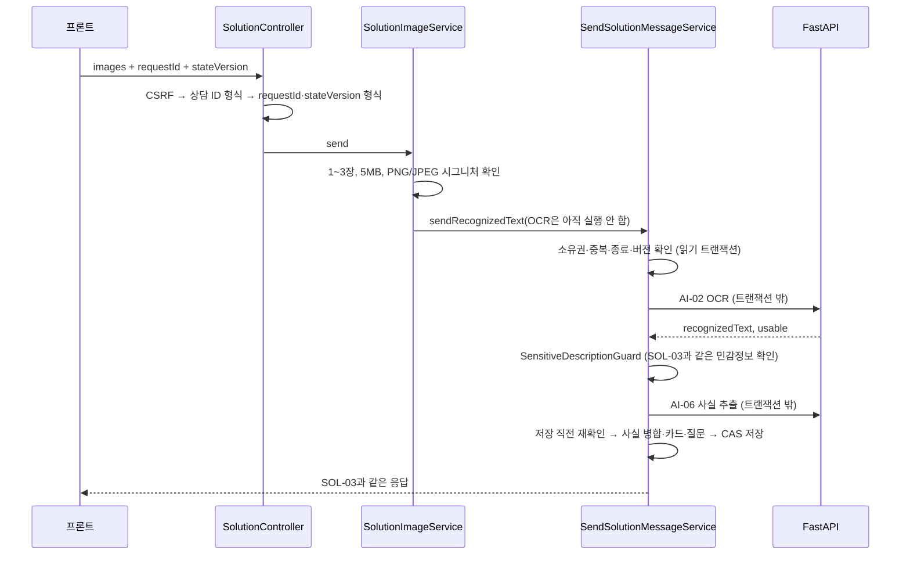

# SOL-06 피해 대응 사진 입력

피해 대응 상담에서 사용자가 문자·카톡 캡처 같은 사진을 올리면, 사진 속 글자를 읽어 **직접 쓴 설명(SOL-03 텍스트)과 같은 흐름**으로 상담에 반영해요. 읽은 글자는 LLM의 사실 추출에 쓰이고, 그 사실로 대응 카드와 다음 질문이 정해져요.

- API ID `SOL-06`은 이 저장소에서 붙인 **초안 ID**예요. 노션 명세에 추가할 때 확정해요.
- 훈련 TRN-05(`/api/trainings/{id}/discovery/images`)는 제거했어요. 그 파일 검증 코드를 여기로 옮겼어요.
- FastAPI OCR(AI-02)은 [AI-02 문서](ai-02-ocr.md)를 참고해요.

## 왜 이렇게 만들었나

- **훈련에서 사진 입력을 쓰지 않기로 해서** TRN-05를 빼고, 같은 검증을 피해 대응에 붙였어요.
- 상담의 LLM 경로는 이미 **설명 → 민감정보 확인 → AI-06 사실 추출 → 병합 → 카드·질문**으로 정해져 있어요. 사진 글자를 새 경로로 처리하지 않고 이 경로에 그대로 넣으면 검증·저장·동시성 규칙을 다시 만들 필요가 없어요.
- 상담 정책은 "민감정보가 보이면 가리지 않고 거부"예요. FastAPI OCR도 민감정보가 보이면 글자를 비우고 `usable=false`를 돌려주므로 정책이 같아요.

## API

```
POST /api/solutions/sessions/{id}/images
Content-Type: multipart/form-data
X-CSRF-TOKEN: <GET /api/solutions/csrf로 받은 토큰>
Cookie: SESSION=...
```

| 파트 | 필수 | 형식 |
|---|---|---|
| `images` | O | 이미지 1~3장. PNG·JPEG, 장당 5MB |
| `requestId` | O | UUID. 메시지마다 새 값 (중복 전송 방지) |
| `stateVersion` | O | 직전 응답의 `stateVersion` |

성공 응답은 **SOL-03과 같은 모양**이에요.

```json
{
  "success": true,
  "data": {
    "facts": {"transferredMoney": "YES", "sharedInformation": "UNKNOWN", "installedApp": "UNKNOWN", "contactContinues": "UNKNOWN"},
    "responseCards": [...],
    "nextQuestion": {"factKey": "sharedInformation", ...},
    "stateVersion": 1
  }
}
```

## 처리 순서



- 파일·소유권·버전이 틀리면 **OCR을 부르지 않아요.** 남의 상담이나 오래된 화면에서 온 요청으로 AI를 쓰지 않게 했어요.
- AI 호출 중에는 DB 트랜잭션을 잡지 않아요. 저장은 SOL-03과 같은 CAS 한 번이에요.

## 저장하는 것과 저장하지 않는 것

| 항목 | 저장 |
|---|---|
| 원본 이미지 | X. 요청 동안 메모리에만 있고 FastAPI로 보낸 뒤 버려요 |
| 원래 파일 이름 | X. AI 서비스에는 `image.png`/`image.jpg`로 보내요 |
| 읽은 글자 | X. AI-06 요청에만 써요 (SOL-03 설명 원문과 같은 정책) |
| 대화 기록 | 고정 문구 `사진 속 내용을 제출했습니다.` + requestId |
| 추출한 사실·카드·질문 | O (SOL-03과 같음) |

## 오류

| 상황 | HTTP | 코드 | 화면 |
|---|---|---|---|
| CSRF 없음 | 403 | `CSRF_TOKEN_INVALID` | 토큰 다시 받기 |
| 상담 ID 형식 오류, 남의 상담, 없는 상담 | 404 | `SOLUTION_NOT_FOUND` | 처음으로 |
| 파트 누락·형식 오류, 사진 0장, PNG/JPEG 아님 | 400 | `INVALID_REQUEST` | 입력 확인 |
| 4장 이상, 장당 5MB 초과 | 413 | `FILE_TOO_LARGE` | 장수·크기 안내 |
| 같은 requestId 재전송 | 409 | `DUPLICATE_REQUEST` | 상태 다시 조회 |
| 버전이 오래됨 | 409 | `STATE_VERSION_CONFLICT` | 상태 다시 조회 |
| 종료된 상담 | 409 | `SOLUTION_FINISHED` | 결과 화면 |
| 글자를 읽지 못함, 빈 글자, 1000자 초과 | 422 | `OCR_FAILED` | **직접 입력 안내** |
| 사진에 민감정보 | 400 | `SENSITIVE_DATA_DETECTED` | 민감정보 빼고 직접 입력 안내 |
| AI 서비스 장애 (OCR 또는 AI-06) | 503 | `AI_SERVICE_UNAVAILABLE` | 잠시 후 다시 또는 직접 입력 |

오류일 때는 대화 기록·사실·버전 모두 바뀌지 않아요.

## 바뀐 파일

| 파일 | 변경 |
|---|---|
| `solution/controller/SolutionController.java` | `POST /sessions/{id}/images` 추가, multipart 파트 검증 |
| `solution/security/SolutionSecurityConfig.java` | SOL-06 경로 허용 (CSRF는 그대로 필요) |
| `solution/service/SolutionImageService.java` | 신규. TRN-05의 장수·크기·PNG/JPEG 검증 이전, OCR 결과 → 오류 코드 변환 |
| `solution/service/SendSolutionMessageService.java` | `sendRecognizedText` 추가. 기존 SOL-03 텍스트 처리를 공용 메서드로 분리 |
| `solution/dto/SendSolutionMessageRequest.java` | 읽은 글자로 요청을 만드는 `recognizedText` 추가 |
| `training/controller/TrainingsController.java`, `training/service/TrainingWorkflow.java`, `training/dto/TrainingResponses.java` | TRN-05 제거 |
| `ai/` (`AiClient.extractText`, `HttpAiClient`, `FakeAiClient`) | 변경 없음. 기존 AI-02 어댑터를 그대로 사용 |

## 테스트

`./gradlew test` (DB 없이) 전체 1012개 통과.

| 테스트 | 확인하는 것 |
|---|---|
| `SolutionImageServiceTest` (5) | PNG/JPEG 시그니처 판별, 원래 파일 이름 숨김, 0장·4장·5MB 초과·가짜 이미지 거부, 잘못된 파일이면 AI·상담 호출 없음, OCR 결과별 오류 코드 |
| `SendSolutionMessageServiceTest` (+3) | OCR·AI-06이 트랜잭션 밖에서 실행, 읽은 글자가 AI-06 설명으로 전달, 기록에는 고정 문구만 저장, 중복·버전·소유권 오류면 OCR 미호출, 민감정보·OCR 실패 시 저장 없음 |
| `SolutionWebSecurityTest` (+3) | 실제 보안 체인·multipart 바인딩으로 성공 흐름, CSRF → ID → 파트 → 소유권 검증 순서, `OCR_FAILED`·`SENSITIVE_DATA_DETECTED` 응답과 무변경 |

DB 테스트(`dbTest`)와 통합 테스트는 PostgreSQL·Redis가 필요해 이 환경에서는 실행하지 않았어요. 실제 FastAPI(Tesseract)와의 연결도 아직 확인하지 않았어요.

## 남은 것

- 노션 명세에 SOL-06 추가와 ID 확정, TRN-05 제거 반영
- 프론트: 사진 첨부 UI, `OCR_FAILED`·`SENSITIVE_DATA_DETECTED`일 때 직접 입력 안내
- 실제 FastAPI(Tesseract 설치)와 연결 확인, 한글 캡처 인식률 확인 후 OCR 엔진 교체 검토
- 근거 검색: 지금 사진 글자는 AI-06 사실 추출에 쓰이고, 그 사실로 검토된 대응 카드와 다음 질문이 정해져요. Spring 상담 흐름은 아직 AI-07(`/explain`, RAG 근거 설명)을 부르지 않아요. 사진 글자를 RAG 검색어로도 넘기려면 AI-07 연결 때 요청에 넣을지 함께 정해요. 원문을 저장하지 않으므로 같은 요청 안에서 넘겨야 해요
