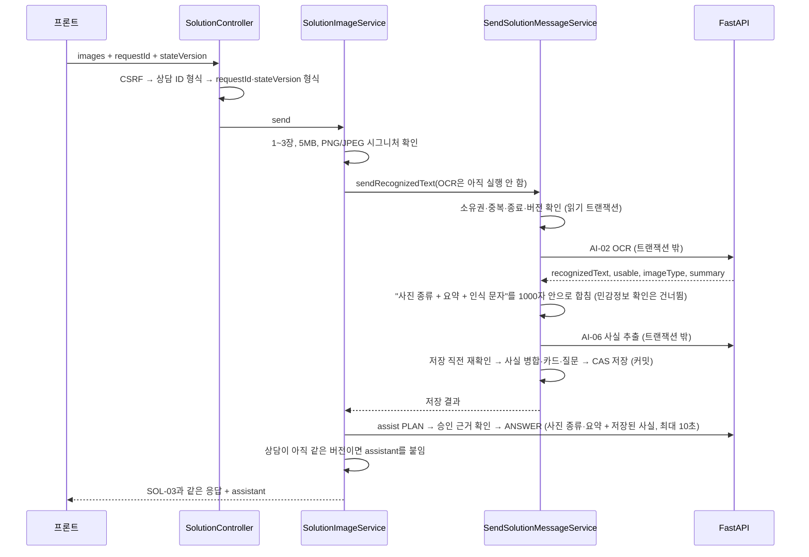

# SOL-06 피해 대응 사진 입력

피해 대응 상담에서 사용자가 문자·카톡 캡처 같은 사진을 올리면, 사진 속 글자를 읽어 **직접 쓴 설명(SOL-03 텍스트)과 같은 흐름**으로 상담에 반영해요. 읽은 글자는 LLM의 사실 추출에 쓰이고, 그 사실로 대응 카드와 다음 질문이 정해져요.

- API ID `SOL-06`은 이 저장소에서 붙인 **초안 ID**예요. 노션 명세에 추가할 때 확정해요.
- 훈련 TRN-05(`/api/trainings/{id}/discovery/images`)는 제거했어요. 그 파일 검증 코드를 여기로 옮겼어요.
- FastAPI OCR(AI-02)은 [AI-02 문서](ai-02-ocr.md)를 참고해요.

## 왜 이렇게 만들었나

- **훈련에서 사진 입력을 쓰지 않기로 해서** TRN-05를 빼고, 같은 검증을 피해 대응에 붙였어요.
- 상담의 LLM 경로는 이미 **설명 → AI-06 사실 추출 → 병합 → 카드·질문**으로 정해져 있어요. 사진 글자를 새 경로로 처리하지 않고 이 경로에 그대로 넣으면 검증·저장·동시성 규칙을 다시 만들 필요가 없어요.
- **사진은 민감정보 확인을 건너뛰어요.** 송금 내역·문자 캡처에는 계좌·전화번호가 찍히는 게 보통이라, 거부하면 사진 입력을 쓸 수 없어요. FastAPI는 원문을 그대로 돌려주고 Gemini에 보낼 때만 가려요. 일반 채팅 입력(SOL-03 TEXT)은 계속 `SENSITIVE_DATA_DETECTED`로 거부해요.
  - 건너뛰기는 서버 안에서 사진 서비스가 부를 때만 켜져요(`sendRecognizedText`). 공개 JSON 요청으로는 켤 수 없어요.
- 사실 저장 뒤 **대응 안내(assist)를 한 번 요청**해 `assistant`에 담아요. 안내가 실패해도 이미 저장된 사실과 카드는 그대로 응답해요.

## API

```
POST /api/solutions/sessions/{id}/images
Content-Type: multipart/form-data
X-CSRF-TOKEN: <GET /api/solutions/csrf로 받은 토큰>
Cookie: SESSION=...
```

| 파트 | 필수 | 형식 |
|---|---|---|
| `images` | O | 이미지 1~3장. PNG·JPEG, 장당 5MB |
| `requestId` | O | UUID. 메시지마다 새 값 (중복 전송 방지) |
| `stateVersion` | O | 직전 응답의 `stateVersion` |

성공 응답은 **SOL-03과 같은 모양**이에요.

```json
{
  "success": true,
  "data": {
    "facts": {"transferredMoney": "YES", "sharedInformation": "UNKNOWN", "installedApp": "UNKNOWN", "contactContinues": "UNKNOWN"},
    "responseCards": [...],
    "nextQuestion": {"factKey": "sharedInformation", ...},
    "stateVersion": 1,
    "assistant": {"status": "ANSWERED", "answer": "...", "referenceCodes": ["..."], "question": null, "reasonCode": null}
  }
}
```

- `assistant`는 안내를 만들었을 때만 값이 있고, 근거 없음·범위 밖·AI 장애·시간 초과면 `null`이에요. 이때도 HTTP 200이에요.
- 지금은 승인 근거 파일이 비어 있어서(검토 완료 0건) `assistant`가 항상 `null`이에요.

## 처리 순서



- 파일·소유권·버전이 틀리면 **OCR을 부르지 않아요.** 남의 상담이나 오래된 화면에서 온 요청으로 AI를 쓰지 않게 했어요.
- AI 호출 중에는 DB 트랜잭션을 잡지 않아요. 저장은 SOL-03과 같은 CAS 한 번이에요.
- 사실 추출에 보내는 글자 예: `사진 종류: 송금 내역\n요약: 50만원 송금 내역\n인식 문자: ...`. 1000자를 넘으면 인식 문자 뒤쪽을 잘라요(전에는 `OCR_FAILED`).
- 대응 안내 질문에는 **사진 종류와 요약**을 넣어요. 예: `사진 종류: 문자 메시지 / 사진 내용: 택배 주소 불일치를 이유로 링크 접속을 요구하는 문자 / 이 사진과 확인된 피해 사실을 기준으로 지금 해야 할 대응 방법을 안내해 주세요.` 그래야 같은 사실이라도 사진 내용에 맞는 안내가 나와요.
- 사진 원문은 보내지 않아요. 요약에 계좌·전화번호 같은 숫자(`SensitiveDescriptionGuard` 기준)나 링크가 보이면 요약도 빼고 종류만 보내요. 추가 질문은 하지 않아요(`remainingClarifications=0`).
- 안내를 기다리는 사이 다른 요청으로 상태가 바뀌었거나 상담이 끝났으면, 오래된 안내는 붙이지 않아요.
- **대기 시간:** OCR 30초(`AI_OCR_READ_TIMEOUT`), 사실 추출 20초, 안내 10초(`AI_IMAGE_ADVICE_TIMEOUT`, 부가 기능이라 짧게)라 최악이면 한 요청이 약 60초예요. 프론트 요청 제한 시간은 이보다 길게 둬요.

## 저장하는 것과 저장하지 않는 것

| 항목 | 저장 |
|---|---|
| 원본 이미지 | X. 요청 동안 메모리에만 있고 FastAPI로 보낸 뒤 버려요 |
| 원래 파일 이름 | X. AI 서비스에는 `image.png`/`image.jpg`로 보내요 |
| 읽은 글자·요약 | X. AI-06 요청에만 써요. 민감정보가 가려지지 않은 원문이라 로그에도 길이만 남겨요 |
| 대화 기록 | 고정 문구 `사진(송금 내역)을 제출했습니다.` + requestId. 괄호 안은 사진 종류 이름(문자 메시지·메신저 대화·송금 내역·웹페이지·기타 자료) |
| 대응 안내(assistant) | X. 응답에만 담아요(SOL-03 assist와 같음) |
| 추출한 사실·카드·질문 | O (SOL-03과 같음) |

## 오류

| 상황 | HTTP | 코드 | 화면 |
|---|---|---|---|
| CSRF 없음 | 403 | `CSRF_TOKEN_INVALID` | 토큰 다시 받기 |
| 상담 ID 형식 오류, 남의 상담, 없는 상담 | 404 | `SOLUTION_NOT_FOUND` | 처음으로 |
| 파트 누락·형식 오류, 사진 0장, PNG/JPEG 아님 | 400 | `INVALID_REQUEST` | 입력 확인 |
| 4장 이상, 장당 5MB 초과 | 413 | `FILE_TOO_LARGE` | 장수·크기 안내 |
| 같은 requestId 재전송 | 409 | `DUPLICATE_REQUEST` | 상태 다시 조회 |
| 버전이 오래됨 | 409 | `STATE_VERSION_CONFLICT` | 상태 다시 조회 |
| 종료된 상담 | 409 | `SOLUTION_FINISHED` | 결과 화면 |
| 글자를 읽지 못함, 빈 글자 | 422 | `OCR_FAILED` | **직접 입력 안내** |
| AI 서비스 장애 (OCR 또는 AI-06) | 503 | `AI_SERVICE_UNAVAILABLE` | 잠시 후 다시 또는 직접 입력 |
| 대응 안내만 실패 | 200 | (없음) | 사실·카드는 반영됨, `assistant: null` |

- 오류일 때는 대화 기록·사실·버전 모두 바뀌지 않아요.
- 사진에 민감정보가 있어도 `SENSITIVE_DATA_DETECTED`를 내지 않아요(위 "왜 이렇게 만들었나" 참고).

## 바뀐 파일

| 파일 | 변경 |
|---|---|
| `solution/controller/SolutionController.java` | `POST /sessions/{id}/images` 추가, multipart 파트 검증 |
| `solution/security/SolutionSecurityConfig.java` | SOL-06 경로 허용 (CSRF는 그대로 필요) |
| `solution/service/SolutionImageService.java` | TRN-05 검증 이전. OCR 결과 → 상담 입력(종류·요약·원문 합치기), 저장 뒤 안내 붙이기 |
| `solution/service/SolutionImageAdviceService.java` | 신규. 사진 종류·요약을 넣은 질문으로 assist PLAN→ANSWER 한 번, 실패·시간 초과는 null |
| `solution/service/SendSolutionMessageService.java` | `sendRecognizedText`(사진 전용, 민감정보 확인 건너뜀). SOL-03 텍스트는 그대로 검사 |
| `solution/dto/SendSolutionMessageRequest.java` | 읽은 글자로 요청을 만드는 `recognizedText` 추가 |
| `ai/dto/OcrExtractResult.java`, `ai/dto/OcrImageType.java` | `imageType`·`summary` 추가. 모르는 종류·분류 실패는 `OTHER`·`null` |
| `ai/HttpAiClient.java`, `ai/AiProperties.java` | AI-02 응답을 필드별로 검사, OCR 전용 응답 제한(기본 30초) |
| `application.yml` | `ocr-read-timeout`, `image-advice-timeout` |
| `training/...` | TRN-05 제거 |

## 테스트

단위 1023 · DB 50 · 통합 33 통과.

| 테스트 | 확인하는 것 |
|---|---|
| `SolutionImageServiceTest` | 파일 검증, OCR 실패만 `OCR_FAILED`, 민감정보(usable=false)는 진행, 종류·요약·원문 합치기와 1000자 자르기(이모지 안 깨짐), 기록 문구, 안내는 같은 버전일 때만 붙이고 실패해도 저장 결과 반환 |
| `SolutionImageAdviceServiceTest` | 질문에 종류·요약 포함(원문 없음), 숫자·링크가 섞인 요약은 제외, 추가 질문 없음, 근거 없음·범위 밖·장애·시간 초과는 null이고 예외 없음 |
| `SendSolutionMessageServiceTest` | 사진은 계좌번호가 있어도 진행·원문 미저장, 같은 글자를 채팅으로 보내면 `SENSITIVE_DATA_DETECTED`, 세션 확인 전 OCR 미호출 |
| `HttpAiClientOcrTest` | `imageType`·`summary` 수신, 모르는 값·null·누락은 `OTHER`·null, 300자 초과 요약은 null, 타입 오류·봉투 없음은 AI 사용 불가, toString에 원문 없음 |
| `SolutionWebSecurityTest` | 실제 보안 체인·multipart로 성공 흐름, 검증 순서, `OCR_FAILED`, 민감정보 사진 200·원문 미저장 |

실제 FastAPI(PaddleOCR)와의 연결은 아직 확인하지 않았어요.

## 남은 것

- 노션 명세에 SOL-06 추가와 ID 확정, TRN-05 제거 반영
- 프론트: 사진 첨부 UI, `OCR_FAILED`일 때 직접 입력 안내, `assistant` 표시, 긴 요청 대기 시간
- 실제 FastAPI(WSID_AI `feature/ocr-paddle`, PaddleOCR)와 연결 확인. Gemini 모델 설정 문제가 풀리기 전에는 `imageType`이 대부분 `OTHER`예요
- 사진 민감정보를 허용하는 정책 변경을 팀과 노션 명세에 반영
- 근거 검색: 지금 사진 글자는 AI-06 사실 추출에 쓰이고, 그 사실로 검토된 대응 카드와 다음 질문이 정해져요. Spring 상담 흐름은 아직 AI-07(`/explain`, RAG 근거 설명)을 부르지 않아요. 사진 글자를 RAG 검색어로도 넘기려면 AI-07 연결 때 요청에 넣을지 함께 정해요. 원문을 저장하지 않으므로 같은 요청 안에서 넘겨야 해요
